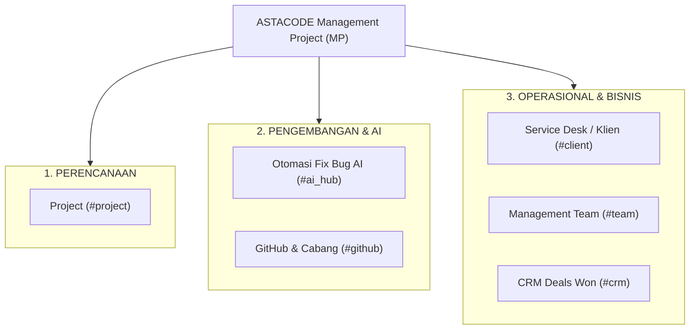
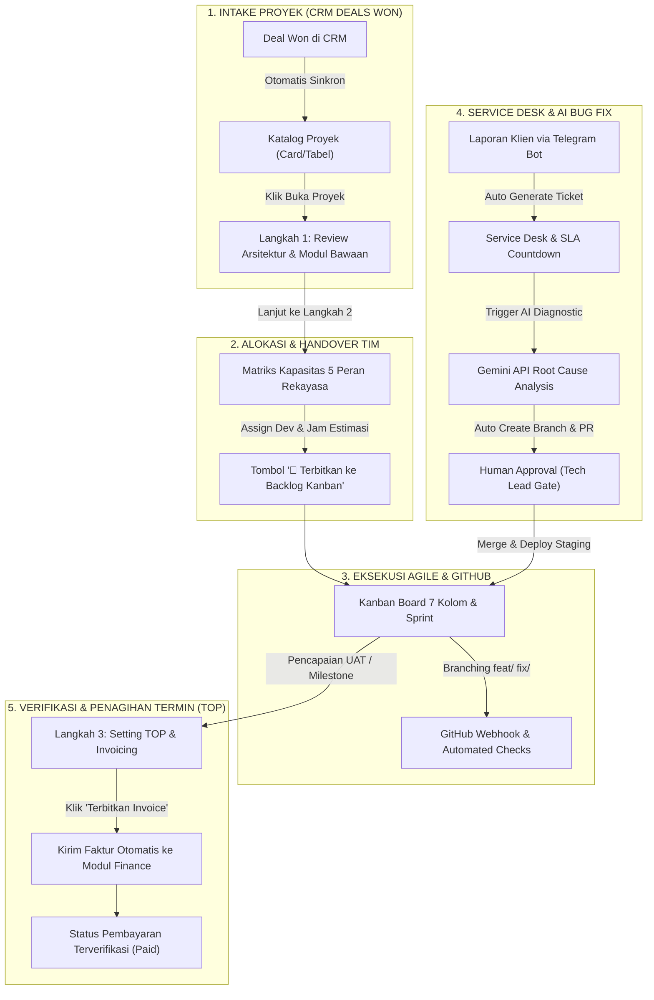
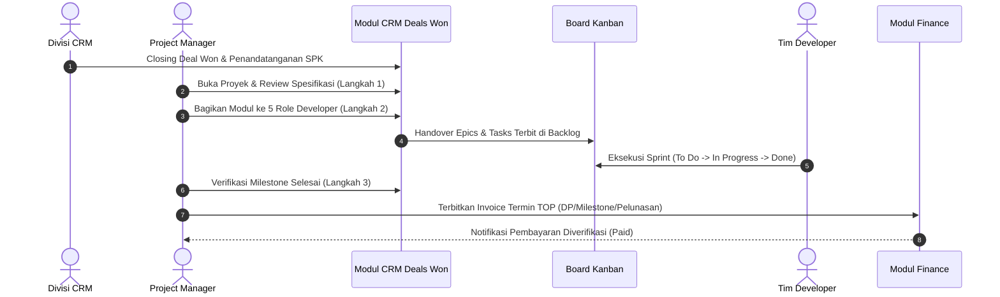
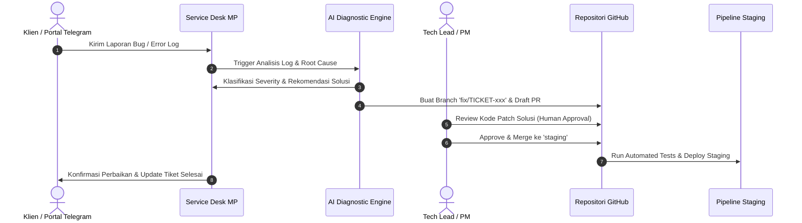

# PRODUCT REQUIREMENT DOCUMENT (PRD) RESUME
# MODUL MANAGEMENT PROJECT (PROJECT MANJER — MP)
### Enterprise Software House Project Delivery, Engineering Collaboration & AI Bug Automation Platform

---

| Dokumen | Keterangan |
| :--- | :--- |
| **Nama Modul** | Management Project (`MP` / Project Manjer) |
| **Versi Dokumen** | 3.2 (Clean Vanilla JS Enterprise Release) |
| **Platform** | ASTACODE ERP Platform |
| **Status Sistem** | Production Ready / Fully Integrated Prototype |
| **Lokasi Modul** | `d:\PROJECT SAYA\prototype-erpasta\MP\` |
| **Target Pengguna** | Project Manager (PM), Lead Developer, Fullstack/Backend/Frontend Engineer, QA Engineer, Klien/Stakeholder |

---

## 1. Ringkasan Eksekutif & Visi Produk

### 1.1 Visi Produk
**Project Manjer (MP)** adalah platform manajemen delivery perangkat lunak enterprise yang dirancang khusus untuk ekosistem software house dan digital agency. Modul ini mengadopsi standar alur kerja kelas dunia setara **Atlassian Jira**, **Linear**, dan **GitLab**, dengan tujuan utama menjadi **Single Source of Truth** untuk seluruh siklus hidup proyek: mulai dari konversi kontrak penjualan (**CRM Deal Won**), pembagian modul dan beban kerja pengembang (**Resource Allocation**), eksekusi papan ketangkasan (**Agile Kanban Board**), penanganan isu otomatis berbasis kecerdasan buatan (**AI Bug Automation**), hingga tata kelola termin pembayaran (**Setting TOP & Invoicing ke Finance**).

### 1.2 Masalah yang Diselesaikan
1. **Silo Antar Divisi**: Penjualan (CRM), operasional teknis (PM/Developer), dan keuangan (Finance) seringkali terpisah, menyebabkan keterlambatan kickoff proyek dan miss-komunikasi invoice termin.
2. **Laporan Bug Tercecer**: Keluhan dan isu klien tersebar di berbagai kanal (Telegram, WhatsApp, email) tanpa pelacakan SLA atau riwayat penanganan yang terstandar.
3. **Kapasitas Tim Tidak Transparan**: Sering terjadi overload kerja pada pengembang tertentu karena tidak adanya matriks kapasitas lintas peran yang real-time.
4. **Proses Debugging Berulang**: Bug umum membutuhkan waktu investigasi manual yang lama untuk pembacaan stack trace dan pembuatan branch/PR perbaikan.

---

## 2. Batasan Teknis & Standar Arsitektur (Tech Stack)

Sesuai pedoman arsitektur sistem ASTACODE, modul MP dibangun dengan prinsip **Native Performance & Zero Heavy Frameworks**:

* **Core Frontend**: HTML5 Semantic + CSS3 Native + Vanilla JavaScript (ES6 Modules).
* **Zero UI Framework Dependencies**: Tidak menggunakan React, Vue, jQuery, Tailwind CSS, atau Bootstrap untuk runtime inti MP vanilla.
* **State Management**: Reactive Pub/Sub Store terpusat (`MP/vanilla/src/state/store.js`) yang mengelola state proyek, tugas, tim, notifikasi, dan pengaturan GitHub secara terisolasi dan reaktif.
* **Desain & Tipografi**:
  * Menggunakan sistem grid 8-pt standar Jira/Linear.
  * Hierarki tipografi yang konsisten: Inter / Sans-Serif untuk teks operasional dan JetBrains Mono untuk kode/ID teknis.
  * Ikon vektor SVG murni (Lucide-based) tanpa icon font eksternal atau emoji dekoratif yang berlebihan.
* **Layouting**: 70/30 Two-Column Split Layout untuk Task Detail Modal (Main Area & Sticky Metadata Sidebar).

---

## 3. Arsitektur Informasi & Struktur Navigasi

Di dalam navigasi master ERP ASTACODE, modul **Management Project** terbagi menjadi 3 pilar operasional utama:

---

## 4. Transformasi Alur Kerja: Dari Manual Menjadi Tersistem

Transformasi operasional pada modul MP membedakan secara tegas antara cara kerja konvensional (manual & terfragmentasi) dengan cara kerja modern (tersistem & terintegrasi end-to-end):

### 4.1 Kondisi Operasional Manual (As-Is / Sebelum Tersistem)
Pada software house tradisional tanpa sistem terintegrasi, operasional delivery menemui berbagai hambatan:
1. **Sales Handover ke PM via Chat**:
   * Penjualan yang berhasil closing (Deal Won) dikomunikasikan secara informal melalui WhatsApp atau spreadsheet terpisah.
   * PM harus membaca ulang dokumen penawaran teknis (Word/PDF), mengetik ulang daftar fitur, dan menyusun breakdown modul secara manual.
   * Sering terjadi salah paham terkait ruang lingkup (*scope creep*) karena tidak ada batasan kontrak yang terkunci otomatis.
2. **Pembagian Tugas & Estimasi Subjektif**:
   * PM membagikan modul ke developer lewat pesan teks grup atau rapat kickoff yang berlarut-larut.
   * Estimasi jam kerja hanya berdasarkan intuisi; tim Backend sering kelebihan beban (*overload*) sementara tim Frontend atau QA menganggur (*idle*) tanpa ada visibilitas kapasitas nyata.
3. **Pelacakan Eksekusi Tercecer**:
   * PM menanyakan kemajuan pekerjaan satu per satu secara manual ("Fitur A sudah sampai mana?").
   * Tiket pekerjaan di Trello/Jira terpisah dari repositori GitHub, sehingga commit dan pull request tidak terlacak statusnya secara langsung.
4. **Laporan Bug & Komplain Klien Berserakan**:
   * Klien menyampaikan keluhan di grup WhatsApp/Telegram pribadi tanpa nomor tiket, tanpa format error log, dan tanpa batasan SLA garansi.
   * Laporan sering tenggelam, tidak jelas siapa penanggung jawabnya, dan developer diganggu langsung oleh klien di luar jam kerja.
5. **Debugging & Perbaikan Manual Berulang**:
   * Developer harus membuka server, membaca log mentah secara manual, membuat branch lokal tanpa konvensi, dan menguji sendiri tanpa standar review yang baku.
6. **Penagihan Termin (Invoicing) Sering Terlambat**:
   * Ketika fitur selesai atau lolos UAT, PM lupa memberitahu Finance bahwa milestone telah tercapai.
   * Tim Finance membuat invoice penagihan manual di Excel berhari-hari setelah serah terima, menyebabkan penundaan pembayaran dari klien dan mengganggu arus kas (*cash flow*).

---

### 4.2 Kondisi Operasional Tersistem di ASTACODE MP (To-Be / Setelah Tersistem)
Dengan diterapkannya modul MP, seluruh siklus kerja terstandarisasi menjadi sistem otomatis:

1. **Intake Terpusat (CRM Deals Won - Langkah 1)**:
   * Proyek yang closing di CRM otomatis masuk ke daftar proyek MP lengkap dengan arsitektur teknis, nilai kontrak, mandays budget, dan daftar epics bawaan.
   * Tidak ada input ganda; data ruang lingkup terkunci otomatis sesuai kesepakatan penawaran.
2. **Alokasi Modul Presisi (Langkah 2 - Capacity Matrix)**:
   * PM membagikan modul langsung ke 5 peran rekayasa (*PM, Backend, Frontend, Fullstack, QA*) dengan visibilitas beban kerja jam/mandays real-time.
   * 1-Klik tombol *🚀 Terbitkan ke Backlog Kanban* langsung menciptakan tugas terstruktur di papan Kanban.
3. **Eksekusi Agile & Integrasi GitHub**:
   * Papan Kanban 7 tahap (`Backlog` ➔ `To Do` ➔ `In Progress` ➔ `Code Review` ➔ `In QA` ➔ `Done` ➔ `Released`) dengan kontrol WIP limits.
   * Integrasi VCS GitHub mengunci branch `main`, mengarahkan pengerjaan ke branch `feat/` atau `fix/`, dan mewajibkan review approval sebelum merge.
4. **Service Desk Omnichannel & SLA**:
   * Webhook Telegram Bot (4 kanal) mengonversi pesan keluhan klien menjadi tiket insiden resmi (`TICKET-xxx`) secara instan.
   * SLA countdown timer otomatis menghitung batas waktu respon dan perbaikan berdasarkan kontrak garansi.
5. **Otomasi Fix Bug AI dengan Guardrail**:
   * *AI Diagnostic Engine* (Gemini API) menganalisis stack trace error, menemukan akar masalah, mengklasifikasi keparahan, serta membuat branch `fix/` dan draft PR secara otomatis.
   * *Human-in-the-Loop Approval*: Senior developer memvalidasi kode sebelum merge dan deploy ke staging.
6. **Penagihan Termin Terhubung Langsung (Langkah 3 - Setting TOP)**:
   * Termin pembayaran (30/40/30) langsung mengunci jadwal penagihan berdasarkan milestone deliverable.
   * Tombol *Terbitkan Invoice* menerbitkan nomor faktur resmi (`INV/2026/xx/xxxx`) dan menembakkannya langsung ke antrean modul Finance tanpa perlu dokumen fisik atau input manual berulang.
7. **Navigasi Kembali Bertahap (Step-by-Step Back Navigation)**:
   * Tombol kembali pada eksekusi proyek bergerak mundur berurutan antar tahap (Langkah 3 ➔ Langkah 2 ➔ Langkah 1 ➔ Katalog Proyek), menjaga fokus pengerjaan pengguna agar tidak keluar secara tidak sengaja.

---

### 4.3 Tabel Komparasi Head-to-Head: Manual vs Tersistem ASTACODE MP

| Dimensi Operasional | Alur Kerja Manual (Konvensional) | Alur Kerja Tersistem (ASTACODE MP) | Efisiensi & Dampak |
| :--- | :--- | :--- | :--- |
| **Sales Handover ke Delivery** | Chat WhatsApp informal, proposal PDF terpisah, re-input manual ke spreadsheet. | Sinkronisasi otomatis dari CRM Deals Won ke Langkah 1; arsitektur & epics langsung termuat. | **Kickoff 80% lebih cepat**; nihil kesalahan input data kontrak. |
| **Alokasi SDM & Estimasi** | Rapat panjang, tebak-tebakan jam kerja, sering terjadi overload pada dev tertentu. | Matriks kapasitas 5 peran (*PM, Backend, Frontend, Fullstack, QA*) dengan kalkulasi beban jam real-time. | **Beban kerja seimbang**; eliminasi bottleneck dan idle time. |
| **Handover Tugas ke Papan Kerja** | PM membuat tiket satu per satu secara manual di papan Trello/Jira. | 1-Klik tombol *🚀 Terbitkan ke Backlog Kanban* langsung menciptakan seluruh epics & tasks. | **Handover instan** dalam hitungan detik. |
| **Pelacakan Progress Proyek** | Ditanya manual di grup chat ("sudah selesai belum?"), status tidak transparan. | Board Kanban 7 kolom, WIP limit, roadmap Gantt, JQL search, dan burnup mandays real-time. | **Transparansi 100%**; blocker teridentifikasi sejak dini. |
| **Manajemen Repositori & Cabang** | Branching bebas tanpa aturan, commit langsung ke main, sering merge conflict. | Integrasi aturan cabang GitHub (`main`, `staging`, `develop`, `feat/`, `fix/`) + protected branches. | **Kualitas kode terjamin**; zero unauthorized merge. |
| **Intake Bug & Komplain Klien** | Chat WA pribadi, pesan tenggelam, tanpa nomor tiket, SLA terabaikan. | Omnichannel Telegram Bot (4 kanal) otomatis menerbitkan tiket resmi + SLA countdown timer. | **Zero lost tickets**; kepatuhan SLA garansi terukur. |
| **Proses Debugging & Patching** | Membaca log server manual, investigasi berjam-jam, buat branch perbaikan manual. | AI Diagnostic Engine (Gemini) auto-parse stack trace, Root Cause Analysis, dan auto-generate draft PR. | **Investigasi 60% lebih cepat** dengan kontrol persetujuan manusia. |
| **Penagihan Termin & Invoice** | PM lupa milestone tercapai; koordinasi lambat ke Finance; buat invoice manual di Word/Excel. | Langkah 3 mengunci skema termin (TOP); 1-klik *Terbitkan Invoice* langsung sinkron ke modul Finance. | **Arus kas lancar**; invoice terbit tepat waktu saat milestone selesai. |

---

## 5. Rincian Fitur & Spesifikasi Sub-Modul

### 5.1 Modul Portofolio & Workspace Proyek (`ProjectModuleView.js` & Agile Suite)
Pusat kendali eksekusi proyek dengan navigasi berbasis portofolio dan workspace individual.
* **Workspace Proyek Terpadu (10 Sub-Tab)**:
  1. `Ringkasan`: Dashboard metrik proyek, burnup mandays, status kesehatan delivery, dan persentase deliverable.
  2. `Board Kanban`: Papan agile drag-and-drop dengan 7 tahap standar: **Backlog**, **To Do**, **In Progress**, **Code Review**, **In QA**, **Done**, dan **Released**. Dilengkapi pembatas WIP (Work-in-Progress), grouping swimlane, dan filter cepat.
  3. `Backlog & Sprints`: Pengelolaan backlog epics, perencanaan kapasitas sprint, estimasi story points, dan tombol *Start / Complete Sprint*.
  4. `Roadmap & Timeline`: Tampilan visual Gantt chart interaktif untuk melihat dependensi antar task dan milestone tenggat waktu.
  5. `Daftar Pekerjaan (JQL)`: Grid tabel lanjutan dengan kapabilitas pencarian, sorting multi-kolom, filter status/prioritas, dan ekspor CSV.
  6. `QA & Testing`: Manajemen test matrix, test run, status bug blocking, dan sign-off UAT.
  7. `Docs & Wiki`: Dokumentasi arsitektur sistem, API spec, catatan kickoff, dan PRD proyek.
  8. `Time Tracking`: Log pencatatan jam kerja pengembang per tugas dengan kalkulasi otomatis over-budget alert.
  9. `Finance & Budget Proyek`: Ringkasan alokasi mandays budget vs realisasi biaya teknis proyek.
  10. `Tiket Pekerjaan`: Drawer pencarian dan penelusuran tiket berbasis nomor referensi.

* **Modal Detail Tugas 70/30 Jira Standard (`TaskDetailModal.js` / `TaskDetailView.js`)**:
  * **Kolom Kiri (70%)**: Deskripsi tugas, kriteria penerimaan (Acceptance Criteria), diagnosa akar masalah AI, checklist subtask, riwayat aktivitas, dan thread diskusi komentar.
  * **Kolom Kanan (30% - Sticky Sidebar)**: Assignee, Reporter, Estimasi Jam, Tingkat Prioritas (*Low, Medium, High, Urgent*), Severity, Status SLA, Story Points, Sprint Aktif, dan Label Komponen.

---

### 5.2 Modul Otomasi Fix Bug AI & Intelligent Triage Hub (`AiAutomationHub.js`)
Pusat kendali otomasi rekayasa perangkat lunak berbasis AI Ops & DevOps modern:
* **4 Executive Automation Scorecards (Metrik Kinerja Otomasi)**:
  1. *Status Engine AI & Kill-Switch*: Gemini 2.5 Pro & Claude 3.5 Sonnet Hybrid Engine · Uptime 99.9% Siaga.
  2. *Patch Success Rate*: 94.6% Auto-Fix Lolos Test Suite · Rata-rata 2m 14s / Patch.
  3. *Antrean Bug Proyek*: Total tiket aktif terklasifikasi (*Low, Medium, Hard*) & jumlah siap review PR.
  4. *Efisiensi Jam Developer*: Kalkulasi estimasi jam rekayasa yang dihemat (~42 jam/bulan) dan garansi bebas bug Rp0.
* **5 Tahap Alur Kerja Otomasi (Interactive Workflow Stepper)**:
  * `1. Deteksi & Ingest`: Penangkapan insiden dari Sentry Webhook & Bot Service Desk.
  * `2. Diagnostik & Triage AST`: Parsing pohon sintaksis kode dan klasifikasi otomatis tingkat kesulitan (*Rendah / Sedang / Susah*).
  * `3. Patch & Unit Test`: AI membuat branch `fix/`, menulis patch kode, dan menjalankan *5/5 regression unit tests*.
  * `4. Review & Staging Gate`: Persetujuan *Human-in-the-Loop* (Senior Dev / Tech Lead) sebelum merge ke Staging.
  * `5. Rilis & Monitoring`: Deploy ke Production dilindungi gerbang *Canary Monitoring Sentry 30 Menit* (Auto-Rollback jika error rate > 2.0%).
* **Live AI Fix Studio / Workbench (Split-Screen 40% / 60% Proporsional)**:
  * **Kolom Kiri (40% - Konteks & Analisis Akar Masalah)**:
    * Dropdown selector tiket & tombol skenario cepat: *⚡ Kasus Rendah (Auto-Fix AI)* dan *🛡️ Kasus Susah (Manual Dev)*.
    * Target file kode, stacktrace exception yang diformat jelas, dan *Root Cause Analysis (RCA)* dari Gemini.
    * Kotak *Safety Guardrail*: Menjelaskan alasan keamanan mengapa AI diizinkan auto-deploy atau wajib dialihkan ke Lead Dev.
  * **Kolom Kanan (60% - Meja Kerja Solusi & Eksekusi Alur)**:
    * Mini Stepper siklus hidup tiket dan bar *Keyakinan AI (Confidence Score)*: 96% (Hijau), 84% (Kuning), 46% (Merah).
    * 4 Tab Meja Kerja: `1. Patch Diff` (Sebelum vs Sesudah), `2. Unit Tests` (5/5 Passing), `3. Git Branch & PR`, `4. Telemetri Sentry`.
    * **Action Cluster Bar Kontekstual 1-Klik**: Tombol aksi dinamis sesuai status (`⚡ Jalankan Auto-Fix AI`, `✅ Setujui PR & Merge ke Staging`, `🚀 Deploy ke Production`, `🛠️ Selesaikan Manual oleh Lead Dev`, `↩️ Uji Rollback Darurat`).
* **Antrean Kerja Proporsional (Pipeline Kanban 6 Tahap vs Tabel Detail)**:
  * Mendukung visualisasi Kanban 6 kolom (*Laporan Masuk ➔ Dianalisis AI ➔ Pengerjaan Fix ➔ Review PR ➔ QA Staging ➔ Rilis & Monitor*).
  * Filter klasifikasi instan (*Semua, Rendah, Sedang, Susah, Menunggu Review PR, Staging & Monitoring*).
  * Tombol navigasi langsung **`💬 Ke Service Desk`** untuk menghubungkan penanganan bug dengan komunikasi klien.

---

### 5.3 Modul GitHub & Cabang (`GithubSettingsView.js`)
Pusat kontrol Version Control System (VCS) bergaya antarmuka otentik **GitHub Enterprise** namun versi lebih ringkas, proporsional, dan terintegrasi dengan ekosistem ASTACODE ERP:
* **Header Repositori Otentik GitHub (Sleek & Proportional)**:
  * Breadcrumb navigasi repositori: `astacode / <nama-repositori>` lengkap dengan badge status `Public`.
  * **Project Switcher Terintegrasi**: Memungkinkan pergantian konteks repositori, cabang git, dan PR langsung berdasarkan proyek aktif ERP.
  * **Aksi Repositori Standar**: Tombol counter `👁️ Watch` (3), `⑂ Fork` (5), `⭐ Star` (14).
  * **Tombol Hijau `Code ▾` (Clone Popover)**: Popover interaktif berisi tab clone `HTTPS`, `SSH`, dan `GitHub CLI`, tombol 1-klik salin URL clone, serta tautan unduh `Download ZIP` dan panduan CLI lokal.
* **1-Line Lifecycle Workflow Banner (Ringkasan Alur Kerja Singkat)**:
  * Banner horizontal ramping dan intuitif yang merangkum 5 siklus pengembangan:
    `[ 🌿 1. Buat Cabang ] ➔ [ 💻 2. Commit & Push ] ➔ [ ⚡ 3. Validasi CI/CD ] ➔ [ 🔀 4. Review & Merge PR ] ➔ [ 🚀 5. Rilis Staging/Prod ]`
  * Setiap tahapan dapat diklik langsung untuk melompat secara instan ke tab yang relevan.
* **5 Tab Repositori GitHub Interaktif**:
  1. **`<> Code` (Struktur Berkas & README)**:
     * Toolbar cabang aktif (`🌿 main ▾`) dengan ringkasan jumlah branch dan tag.
     * **Latest Commit Strip**: Avatar pengembang, author, hash commit (`4d19fa2`), pesan conventional commit, dan penanda waktu relatif.
     * **GitHub File Tree Table**: Struktur folder (`app/`, `config/`, `database/`, `routes/`, `tests/`) dan berkas (`Dockerfile`, `.env.example`, `README.md`) dengan pesan commit terakhir dan waktu update.
     * **Rendered README.md Card**: Tampilan formatted markdown yang memuat ringkasan proyek, badge tech stack (PHP 8.2, Laravel 11, Docker, PostgreSQL, Redis), serta panduan quick start lokal.
  2. **`🌿 Branches` (Manajemen Cabang)**:
     * Filter pencarian instan nama cabang / modul dan dropdown kategori (*Semua, Terproteksi, Fitur & Epics, Hotfix & Bug AI*).
     * Bagian **Default Branch** (`main` — protected, base rilis resmi).
     * Bagian **Protected Staging Branch** (`staging` — target merge seluruh PR fitur).
     * Bagian **Active Feature & Bugfix Branches**: Daftar cabang lengkap dengan kartu nama branch, PIC developer, commit hash, perbandingan visual **Ahead/Behind** (`2 ahead · 0 behind`), tombol *New PR*, salin nama branch, dan tombol hapus cabang.
  3. **`🔀 Pull Requests` (Review & Merge PR)**:
     * Kartu PR aktif: `#14 [LIB-116] Implementasi Autentikasi JWT & Sanctum RBAC` dengan target flow `staging ← feature/sanctum-rbac-auth`.
     * 4 Subtab PR: `Conversation` (diskusi & review tim), `Commits (3)` (riwayat commit bertahap), `Checks (6/6 Pass)` (rincian pengujian automated CI), dan `Files changed (2)` (Diff viewer baris kode hijau `+` dan merah `-`).
     * **Otentik GitHub Merge Box**: Status *"This branch has no conflicts with the base branch"* dan tombol hijau **`Squash and merge`** yang secara reaktif menggabungkan cabang ke staging, mengubah status menjadi `Merged` (ungu), memicu toast, dan menyiarkan notifikasi ke bot.
  4. **`⚡ Actions (CI/CD)` (Pipeline Otomasi)**:
     * Rangkuman 6 tahapan pipeline: *Setup Environment (12s)*, *PHPUnit & PHPStan (24s)*, *Trivy Security Scan (18s)*, *Docker Build (48s)*, *Deploy Staging VPS (15s)*, dan *Telegram Bot Alert*.
     * Tombol interaktif **`▶ Jalankan Workflow`** dengan simulasi pengujian dan notifikasi passing.
     * Tabel riwayat proses workflow runs (*success/duration/trigger*).
  5. **`⚙️ Settings` (Pengaturan & Integrasi)**:
     * **Autentikasi & PAT**: Pengelolaan GitHub Personal Access Token (dengan toggle show/hide mata), indikator latency API real-time, sisa rate limit, dan checklist cakupan token scopes (*repo*, *workflow*, *admin:org*, *write:packages*).
     * **Collaborators & Hak Akses**: Daftar tim pengembang dengan badge hak akses (*Admin*, *Write*, *Read*), status 2FA, dan modal undang collaborator.
     * **Webhooks & Telegram Bot**: URL endpoint webhook dan toggle simulasi alert siaran `@ProjectManjerBot`.
* **Modals Terpadu**:
  * **Modal Buat Cabang Baru**: Helper prefix otomatis (`feature/`, `fix/`, `epic/`, `hotfix/`, `ai/`), pemilihan base branch (`staging`/`main`), link modul, dan generator cuplikan Git CLI live.
  * **Modal Tambah Collaborator**: Nama, GitHub handle, role teknis, dan tingkat permission.
  * **Modal Panduan Standar CLI Git ASTACODE**: Cheatsheet checkout, conventional commit, dan push pull request.

---

### 5.4 Modul Service Desk, Bot Omnichannel & Automasi Klien (`ClientPortalView.js`)
Jembatan komunikasi real-time antara klien pemesan aplikasi dengan tim rekayasa, dilengkapi sistem bot kustom dan otomasi penuh:
* **Fitur Pembuatan & Manajemen Bot Layanan Baru (+ Buat Bot Baru)**:
  * Pengguna dapat membuat dan mendaftarkan bot baru langsung dari UI (mendukung *Telegram Bot API*, *WhatsApp Cloud API*, *Slack Webhook*, dan *Custom REST Webhook*).
  * Konfigurasi mencakup: handle/nama bot (`@NamaBot`), token API / secret, webhook endpoint URL, batas target SLA (15m, 30m, 60m), pesan sambutan kustom, dan toggle auto-sync AI.
  * Dropdown switcher bot aktif pada header memungkinkan perpindahan antar bot secara instan.
* **Sinkronisasi Penuh dengan Modul Otomasi Fix Bug AI (`AiAutomationHub.js`)**:
  * Setiap laporan kendala dari bot langsung terhubung ke *Intelligent Orchestrator* (Gemini API & Claude Coding Agent).
  * Tombol aksi 1-klik di chat stream (**⚡ Jalankan Auto-Fix AI**) yang langsung memicu analisis AST, checkout branch `fix/`, pembuatan patch, dan pengujian 5/5 unit regression tests.
  * Tombol pintasan langsung **🚀 Buka di Studio AI Hub** untuk melihat Root Cause Analysis dan diff PR secara mendalam di workbench AI.
  * Bot secara otomatis mengirimkan kabar status ke ruang obrolan saat PR patch berhasil dibuat atau di-deploy.
* **Formulir Laporan Bug Terstruktur (🚨 Lapor Kendala / Bug)**:
  * Modal input pelaporan bug resmi dengan field keparahan (*S1 Critical Blocker 30m, S2 Major 120m, S3 Minor 8h*), lingkungan (*Production, Staging, UAT*), dan langkah reproduksi.
  * Opsi checkbox untuk langsung mengeksekusi analisis otomatis AI saat tiket diterbitkan.
* **Pusat Aturan Automasi Service Desk (⚡ Automasi & Webhook)**:
  * 5 aturan automasi terpadu: Auto-Triage & Klasifikasi, Sinkronisasi Dua Arah AI Hub, Routing Otomatis ke On-Call Dev Siaga, Notifikasi Webhook Balasan ke Grup Klien, serta SLA Countdown & Safety Escalation Guardrail.
* **Arena Obrolan Telegram 3 Kolom Proporsional & Transparansi Klien**:
  * Kolom Kiri: **Seluruh Bot Layanan (@ProjectManjerBot, @AstaPosTelematicsBot, @LogistikCareBot, dan bot baru) langsung masuk ke daftar chat** lengkap dengan tab filter (*Semua*, *Bot Layanan*, *Tim Dev*), avatar platform, badge kode proyek, status online, indikator AI Sync, dan snippet pesan terakhir. Setiap pergantian bot otomatis menyinkronkan proyek aktif ERP.
  * Kolom Tengah: Aliran obrolan Telegram interaktif dengan quick commands (`/status`, `/autofix`, `/sync`, `/human`, `/invoice`, `/sla`), indikator mengetik, dan tombol inline responsif.
  * Kolom Kanan: Panel transparansi kuota maintenance bulanan, widget live pipeline Otomasi Fix Bug AI, profil kontrak, dan riwayat termin faktur.

---

### 5.5 Modul Management Team & Kapasitas SDM (`HrTeamView.js`)
Matriks visibilitas kapasitas sumber daya manusia di software house:
* **Matriks 5 Peran Rekayasa Utama**:
  1. **Project Manager (PM)** — *Asisyah Sarah Azzahra*
  2. **Backend Lead** — *Jaka Kurnia*
  3. **Frontend Engineer** — *Aldyana*
  4. **Fullstack Engineer** — *Azi*
  5. **QA & Testing Engineer** — *Parhan*
* **Kalkulasi Utilisasi & Beban Kerja**:
  * Menghitung total jam estimasi per sprint dibandingkan kapasitas kerja reguler (40 jam/minggu).
  * Memberikan indikator visual kapasitas: *Normal (Hijau)*, *Hampir Penuh (Kuning)*, dan *Overload (Merah)*.

---

### 5.6 Modul CRM Deals Won & Alur Eksekusi Terpadu (`CrmDealsView.js`)
Modul integrasi hulu ke hilir yang menghubungkan closing penjualan dari divisi CRM dengan penagihan termin ke divisi Finance:
* **Tampilan Awal Katalog Proyek (Clean Catalog View)**:
  * Saat pertama kali dirender, sistem menampilkan daftar proyek deal won tanpa membuka detail proyek agar halaman tetap bersih dan terfokus.
  * Mendukung dua mode tampilan dengan toggle switch: **Mode Card Grid** (responsif & proporsional) dan **Mode Tabel**.
  * Setiap kartu dan baris tabel dilengkapi tombol **`🚀 Buka Proyek ➔`**.
* **Fitur Step-by-Step Back Navigation (Mundur Berurutan Sesuai Tahap)**:
  * Tombol **Kembali** di bagian atas dan bawah layar tidak langsung melompat keluar ke katalog, melainkan mundur satu langkah ke tahapan sebelumnya:
    * Di **Langkah 3**: tombol bertuliskan `← Kembali ke Langkah 2: Pembagian Modul`.
    * Di **Langkah 2**: tombol bertuliskan `← Kembali ke Langkah 1: Penerimaan Aplikasi`.
    * Di **Langkah 1**: tombol bertuliskan `← Kembali ke Daftar Proyek`.
  * Disediakan tombol pintasan `🗂️ Daftar Proyek` di bilah navigasi atas jika pengguna ingin langsung kembali ke katalog proyek.
* **3 Langkah Alur Eksekusi Proyek**:
  1. **Langkah 1: 📥 Penerimaan Aplikasi & Spesifikasi Modul**:
     * Menampilkan arsitektur teknis sistem dan ruang lingkup kontrak.
     * Grid daftar modul bawaan epics lengkap dengan kode modul, estimasi jam kerja, peran pengembang yang disarankan, dan status kesiapan.
  2. **Langkah 2: 👥 Pembagian Modul ke Developer**:
     * Matriks alokasi modul langsung terikat ke proyek aktif tanpa dropdown select berulang.
     * Pengaturan jam dan peran teknis secara interaktif serta tombol handover langsung: *🚀 Terbitkan ke Backlog Kanban*.
  3. **Langkah 3: 💰 Pengiriman Invoice ke Finance (Setting TOP)**:
     * Menampilkan skema termin pembayaran kontrak (*30/40/30 Down Payment, Progress UAT, Pelunasan Final*).
     * Tombol aksi **`Terbitkan Invoice`** yang secara instan menerbitkan nomor faktur tagihan dan menembakkannya ke modul Finance.
     * Sub-tab *Riwayat Invoice Terbit* untuk memantau status pelunasan faktur.
  4. **Tab Portofolio & SLA**: Ringkasan eksekutif seluruh proyek, jadwal sprint terdekat, dan audit kepatuhan OWASP / CI-CD test pass.

---

## 6. Alur Kerja End-to-End (Workflows)

### 6.1 Alur Proyek Baru (Sales Handover to Delivery)

### 6.2 Alur Otomasi Perbaikan Bug (AI Incident Resolution)

---

## 7. Struktur Data & Entitas Utama (`store.js`)

| Entitas | Atribut Utama | Relasi |
| :--- | :--- | :--- |
| **`projects`** | `id`, `name`, `code`, `status`, `progress`, `contractValue`, `budgetMandays`, `topScheme` | Induk dari Epics, Tasks, dan Sprints |
| **`tasks`** | `id`, `key`, `title`, `description`, `status`, `priority`, `severity`, `assigneeId`, `estimateHours`, `epicId` | Anak dari Project & Epic |
| **`epics`** | `id`, `key`, `name`, `summary`, `color`, `projectId` | Mengelompokkan Tasks |
| **`teamMembers`** | `id`, `name`, `role`, `avatar`, `capacityHours`, `allocatedHours`, `status` | Ditugaskan pada Task & Module |
| **`crmDeals`** | `id`, `title`, `customer`, `value`, `stage`, `scope`, `architecture`, `modules` | Sumber konversi ke Project |
| **`invoices`** | `id`, `invoiceNumber`, `projectId`, `terminName`, `amount`, `dueDate`, `status` | Diterbitkan dari Step 3 ke Finance |
| **`automationRules`** | `id`, `trigger`, `condition`, `action`, `isActive` | Mengatur auto-assign & SLA notification |

---

## 8. Catatan Pembaruan & Optimalisasi Terakhir

1. **Konsolidasi Alur Finansial**:
   * Sub-modul lama *Finance & Invoices* di sidebar Management Project telah **dihapus** demi simplifikasi arsitektur.
   * Seluruh fungsionalitas penagihan termin proyek dipusatkan secara elegan di **CRM Deals Won (Langkah 3 Setting TOP & Pengiriman Invoice)**, sedangkan pembukuan akuntansi penuh ditangani oleh modul independen **Finance & AR/AP**.
2. **Sistem Pemilihan Proyek yang Ergonomis**:
   * Menghilangkan dropdown select berulang. Pemilihan dilakukan satu kali melalui **Card Grid** atau **Tabel** pada katalog proyek.
3. **Mekanisme Back Berurutan**:
   * Tombol kembali (*Back button*) pada navigasi atas dan footer kini mundur secara bertahap antar langkah eksekusi proyek (Langkah 3 ➔ Langkah 2 ➔ Langkah 1 ➔ Katalog Proyek), mencegah keluarnya pengguna secara tidak sengaja ke daftar utama.

---

*Dokumen ini disusun sebagai ringkasan resmi arsitektur dan spesifikasi modul Management Project (MP) pada platform ASTACODE ERP.*
