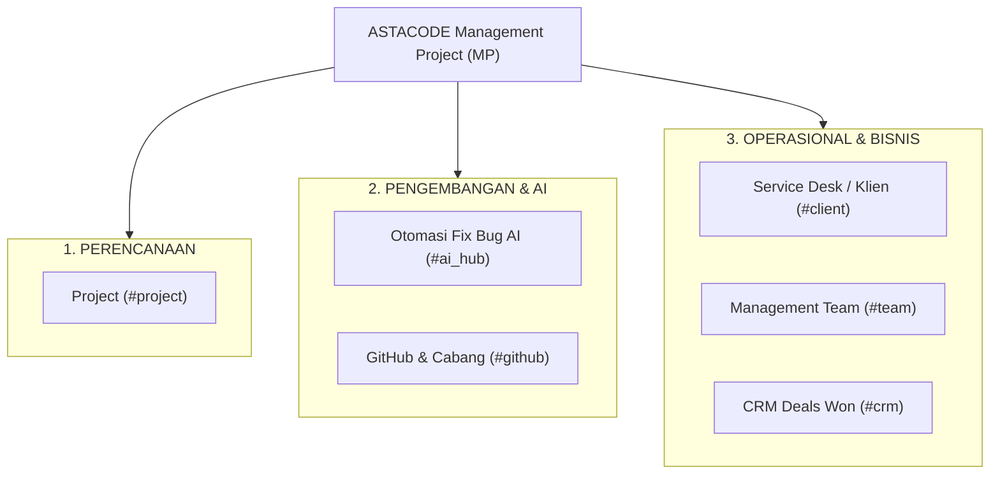
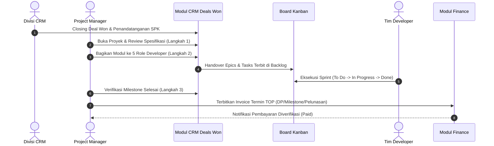
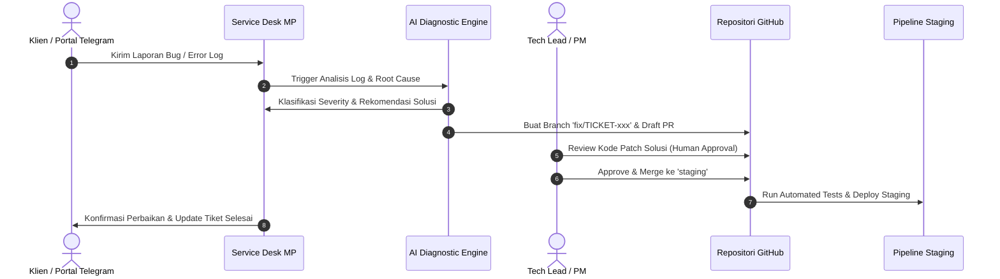

# PRODUCT REQUIREMENT DOCUMENT (PRD) RESUME
# MODUL MANAGEMENT PROJECT (PROJECT MANJER — MP)
### Enterprise Software House Project Delivery, Engineering Collaboration & AI Bug Automation Platform

---

| Dokumen | Keterangan |
| :--- | :--- |
| **Nama Modul** | Management Project (`MP` / Project Manjer) |
| **Versi Dokumen** | 3.2 (Clean Vanilla JS Enterprise Release) |
| **Platform** | ASTACODE ERP Platform |
| **Status Sistem** | Production Ready / Fully Integrated Prototype |
| **Lokasi Modul** | `d:\PROJECT SAYA\prototype-erpasta\MP\` |
| **Target Pengguna** | Project Manager (PM), Lead Developer, Fullstack/Backend/Frontend Engineer, QA Engineer, Klien/Stakeholder |

---

## 1. Ringkasan Eksekutif & Visi Produk

### 1.1 Visi Produk
**Project Manjer (MP)** adalah platform manajemen delivery perangkat lunak enterprise yang dirancang khusus untuk ekosistem software house dan digital agency. Modul ini mengadopsi standar alur kerja kelas dunia setara **Atlassian Jira**, **Linear**, dan **GitLab**, dengan tujuan utama menjadi **Single Source of Truth** untuk seluruh siklus hidup proyek: mulai dari konversi kontrak penjualan (**CRM Deal Won**), pembagian modul dan beban kerja pengembang (**Resource Allocation**), eksekusi papan ketangkasan (**Agile Kanban Board**), penanganan isu otomatis berbasis kecerdasan buatan (**AI Bug Automation**), hingga tata kelola termin pembayaran (**Setting TOP & Invoicing ke Finance**).

### 1.2 Masalah yang Diselesaikan
1. **Silo Antar Divisi**: Penjualan (CRM), operasional teknis (PM/Developer), dan keuangan (Finance) seringkali terpisah, menyebabkan keterlambatan kickoff proyek dan miss-komunikasi invoice termin.
2. **Laporan Bug Tercecer**: Keluhan dan isu klien tersebar di berbagai kanal (Telegram, WhatsApp, email) tanpa pelacakan SLA atau riwayat penanganan yang terstandar.
3. **Kapasitas Tim Tidak Transparan**: Sering terjadi overload kerja pada pengembang tertentu karena tidak adanya matriks kapasitas lintas peran yang real-time.
4. **Proses Debugging Berulang**: Bug umum membutuhkan waktu investigasi manual yang lama untuk pembacaan stack trace dan pembuatan branch/PR perbaikan.

---

## 2. Batasan Teknis & Standar Arsitektur (Tech Stack)

Sesuai pedoman arsitektur sistem ASTACODE, modul MP dibangun dengan prinsip **Native Performance & Zero Heavy Frameworks**:

* **Core Frontend**: HTML5 Semantic + CSS3 Native + Vanilla JavaScript (ES6 Modules).
* **Zero UI Framework Dependencies**: Tidak menggunakan React, Vue, jQuery, Tailwind CSS, atau Bootstrap untuk runtime inti MP vanilla.
* **State Management**: Reactive Pub/Sub Store terpusat (`MP/vanilla/src/state/store.js`) yang mengelola state proyek, tugas, tim, notifikasi, dan pengaturan GitHub secara terisolasi dan reaktif.
* **Desain & Tipografi**:
  * Menggunakan sistem grid 8-pt standar Jira/Linear.
  * Hierarki tipografi yang konsisten: Inter / Sans-Serif untuk teks operasional dan JetBrains Mono untuk kode/ID teknis.
  * Ikon vektor SVG murni (Lucide-based) tanpa icon font eksternal atau emoji dekoratif yang berlebihan.
* **Layouting**: 70/30 Two-Column Split Layout untuk Task Detail Modal (Main Area & Sticky Metadata Sidebar).

---

## 3. Arsitektur Informasi & Struktur Navigasi

Di dalam navigasi master ERP ASTACODE, modul **Management Project** terbagi menjadi 3 pilar operasional utama:

---

## 4. Rincian Fitur & Spesifikasi Sub-Modul

### 4.1 Modul Portofolio & Workspace Proyek (`ProjectModuleView.js` & Agile Suite)
Pusat kendali eksekusi proyek dengan navigasi berbasis portofolio dan workspace individual.
* **Workspace Proyek Terpadu (10 Sub-Tab)**:
  1. `Ringkasan`: Dashboard metrik proyek, burnup mandays, status kesehatan delivery, dan persentase deliverable.
  2. `Board Kanban`: Papan agile drag-and-drop dengan 7 tahap standar: **Backlog**, **To Do**, **In Progress**, **Code Review**, **In QA**, **Done**, dan **Released**. Dilengkapi pembatas WIP (Work-in-Progress), grouping swimlane, dan filter cepat.
  3. `Backlog & Sprints`: Pengelolaan backlog epics, perencanaan kapasitas sprint, estimasi story points, dan tombol *Start / Complete Sprint*.
  4. `Roadmap & Timeline`: Tampilan visual Gantt chart interaktif untuk melihat dependensi antar task dan milestone tenggat waktu.
  5. `Daftar Pekerjaan (JQL)`: Grid tabel lanjutan dengan kapabilitas pencarian, sorting multi-kolom, filter status/prioritas, dan ekspor CSV.
  6. `QA & Testing`: Manajemen test matrix, test run, status bug blocking, dan sign-off UAT.
  7. `Docs & Wiki`: Dokumentasi arsitektur sistem, API spec, catatan kickoff, dan PRD proyek.
  8. `Time Tracking`: Log pencatatan jam kerja pengembang per tugas dengan kalkulasi otomatis over-budget alert.
  9. `Finance & Budget Proyek`: Ringkasan alokasi mandays budget vs realisasi biaya teknis proyek.
  10. `Tiket Pekerjaan`: Drawer pencarian dan penelusuran tiket berbasis nomor referensi.

* **Modal Detail Tugas 70/30 Jira Standard (`TaskDetailModal.js` / `TaskDetailView.js`)**:
  * **Kolom Kiri (70%)**: Deskripsi tugas, kriteria penerimaan (Acceptance Criteria), diagnosa akar masalah AI, checklist subtask, riwayat aktivitas, dan thread diskusi komentar.
  * **Kolom Kanan (30% - Sticky Sidebar)**: Assignee, Reporter, Estimasi Jam, Tingkat Prioritas (*Low, Medium, High, Urgent*), Severity, Status SLA, Story Points, Sprint Aktif, dan Label Komponen.

---

### 4.2 Modul Otomasi Fix Bug AI (`AiAutomationHub.js`)
Inovasi otomasi penanganan insiden bug perangkat lunak menggunakan kecerdasan buatan (Gemini Pro/Flash API):
* **AI Diagnostic Engine**: Membaca otomatis pesan error klien, tangkapan layar, dan exception stack trace sistem.
* **Root Cause Analysis (RCA)**: Mengidentifikasi baris kode yang rusak, memberikan ringkasan penyebab kegagalan, dan menyusun rekomendasi patch solusi.
* **Automated Branch & PR Generation**: Secara otomatis membuat branch perbaikan Git dengan format `fix/<issue-key>-<short-desc>` dan draft Pull Request ke GitHub.
* **Human-in-the-Loop Safety Guardrail**:
  > [!IMPORTANT]
  > AI bertindak sebagai asisten diagnostik. Sistem secara ketat melarang AI melakukan *merge* langsung ke branch utama (`main`) atau *deploy production* tanpa persetujuan manual (approval) dari Senior Developer / Tech Lead.

---

### 4.3 Modul GitHub & Cabang (`GithubSettingsView.js`)
Pusat kontrol integrasi Version Control System (VCS) untuk software house:
* **Pengaturan Repositori & Autentikasi**: Pengelolaan Personal Access Token (PAT), OAuth, dan konfigurasi Webhook dua arah.
* **Strategi Percabangan (Branching Strategy)**:
  * Branch Produksi (`main` / `master`): Terkunci dan terproteksi (*Branch Protection Rules*).
  * Branch Staging (`staging`): Integrasi testing QA.
  * Branch Development (`develop`): Basis pengerjaan fitur harian.
  * Konvensi branch: `epic/` untuk modul besar, `feat/` untuk fitur, dan `fix/` untuk penanganan bug.
* **Otomasi CI/CD & Gate Review**: Syarat minimal 1 code review approval, pemeriksaan automated unit test sebelum merge, dan penyediaan skrip rollback darurat.

---

### 4.4 Modul Service Desk & Portal Klien (`ClientPortalView.js`)
Jembatan komunikasi real-time antara klien pemesan aplikasi dengan tim rekayasa:
* **Integrasi Bot Telegram Terpadu**:
  * Webhook listener terhubung ke 4 kanal bot spesifik: *Channel Umum*, *Channel PM*, *Channel Developer Backend*, dan *Channel Frontend*.
  * Setiap keluhan klien yang masuk otomatis menghasilkan tiket insiden resmi (`TICKET-xxx`).
* **SLA Countdown Timer**: Pelacakan waktu tanggap (Response Time) dan waktu penyelesaian (Resolution Time) berdasarkan kontrak garansi.
* **Client Restricted Access View**: Klien dapat memantau status pengerjaan tiket dan menyetujui pengujian tanpa dapat melihat catatan internal atau diskusi teknis rahasia para developer.

---

### 4.5 Modul Management Team & Kapasitas SDM (`HrTeamView.js`)
Matriks visibilitas kapasitas sumber daya manusia di software house:
* **Matriks 5 Peran Rekayasa Utama**:
  1. **Project Manager (PM)** — *Asisyah Sarah Azzahra*
  2. **Backend Lead** — *Jaka Kurnia*
  3. **Frontend Engineer** — *Aldyana*
  4. **Fullstack Engineer** — *Azi*
  5. **QA & Testing Engineer** — *Parhan*
* **Kalkulasi Utilisasi & Beban Kerja**:
  * Menghitung total jam estimasi per sprint dibandingkan kapasitas kerja reguler (40 jam/minggu).
  * Memberikan indikator visual kapasitas: *Normal (Hijau)*, *Hampir Penuh (Kuning)*, dan *Overload (Merah)*.

---

### 4.6 Modul CRM Deals Won & Alur Eksekusi Terpadu (`CrmDealsView.js`)
Modul integrasi hulu ke hilir yang menghubungkan closing penjualan dari divisi CRM dengan penagihan termin ke divisi Finance:
* **Tampilan Awal Katalog Proyek (Clean Catalog View)**:
  * Saat pertama kali dirender, sistem menampilkan daftar proyek deal won tanpa membuka detail proyek agar halaman tetap bersih dan terfokus.
  * Mendukung dua mode tampilan dengan toggle switch: **Mode Card Grid** (responsif & proporsional) dan **Mode Tabel**.
  * Setiap kartu dan baris tabel dilengkapi tombol **`🚀 Buka Proyek ➔`**.
* **Fitur Step-by-Step Back Navigation (Mundur Berurutan Sesuai Tahap)**:
  * Tombol **Kembali** di bagian atas dan bawah layar tidak langsung melompat keluar ke katalog, melainkan mundur satu langkah ke tahapan sebelumnya:
    * Di **Langkah 3**: tombol bertuliskan `← Kembali ke Langkah 2: Pembagian Modul`.
    * Di **Langkah 2**: tombol bertuliskan `← Kembali ke Langkah 1: Penerimaan Aplikasi`.
    * Di **Langkah 1**: tombol bertuliskan `← Kembali ke Daftar Proyek`.
  * Disediakan tombol pintasan `🗂️ Daftar Proyek` dan dropdown `Ganti Proyek` jika pengguna ingin berpindah secara instan.
* **3 Langkah Alur Eksekusi Proyek**:
  1. **Langkah 1: 📥 Penerimaan Aplikasi & Spesifikasi Modul**:
     * Menampilkan arsitektur teknis sistem dan ruang lingkup kontrak.
     * Grid daftar modul bawaan epics lengkap dengan kode modul, estimasi jam kerja, peran pengembang yang disarankan, dan status kesiapan.
  2. **Langkah 2: 👥 Pembagian Modul ke Developer**:
     * Matriks alokasi modul langsung terikat ke proyek aktif tanpa dropdown select berulang.
     * Pengaturan jam dan peran teknis secara interaktif serta tombol handover langsung: *🚀 Terbitkan ke Backlog Kanban*.
  3. **Langkah 3: 💰 Pengiriman Invoice ke Finance (Setting TOP)**:
     * Menampilkan skema termin pembayaran kontrak (*30/40/30 Down Payment, Progress UAT, Pelunasan Final*).
     * Tombol aksi **`Terbitkan Invoice`** yang secara instan menerbitkan nomor faktur tagihan dan menembakkannya ke modul Finance.
     * Sub-tab *Riwayat Invoice Terbit* untuk memantau status pelunasan faktur.
  4. **Tab Portofolio & SLA**: Ringkasan eksekutif seluruh proyek, jadwal sprint terdekat, dan audit kepatuhan OWASP / CI-CD test pass.

---

## 5. Alur Kerja End-to-End (Workflows)

### 5.1 Alur Proyek Baru (Sales Handover to Delivery)

### 5.2 Alur Otomasi Perbaikan Bug (AI Incident Resolution)

---

## 6. Struktur Data & Entitas Utama (`store.js`)

| Entitas | Atribut Utama | Relasi |
| :--- | :--- | :--- |
| **`projects`** | `id`, `name`, `code`, `status`, `progress`, `contractValue`, `budgetMandays`, `topScheme` | Induk dari Epics, Tasks, dan Sprints |
| **`tasks`** | `id`, `key`, `title`, `description`, `status`, `priority`, `severity`, `assigneeId`, `estimateHours`, `epicId` | Anak dari Project & Epic |
| **`epics`** | `id`, `key`, `name`, `summary`, `color`, `projectId` | Mengelompokkan Tasks |
| **`teamMembers`** | `id`, `name`, `role`, `avatar`, `capacityHours`, `allocatedHours`, `status` | Ditugaskan pada Task & Module |
| **`crmDeals`** | `id`, `title`, `customer`, `value`, `stage`, `scope`, `architecture`, `modules` | Sumber konversi ke Project |
| **`invoices`** | `id`, `invoiceNumber`, `projectId`, `terminName`, `amount`, `dueDate`, `status` | Diterbitkan dari Step 3 ke Finance |
| **`automationRules`** | `id`, `trigger`, `condition`, `action`, `isActive` | Mengatur auto-assign & SLA notification |

---

## 7. Catatan Pembaruan & Optimalisasi Terakhir

1. **Konsolidasi Alur Finansial**:
   * Sub-modul lama *Finance & Invoices* di sidebar Management Project telah **dihapus** demi simplifikasi arsitektur.
   * Seluruh fungsionalitas penagihan termin proyek dipusatkan secara elegan di **CRM Deals Won (Langkah 3 Setting TOP & Pengiriman Invoice)**, sedangkan pembukuan akuntansi penuh ditangani oleh modul independen **Finance & AR/AP**.
2. **Sistem Pemilihan Proyek yang Ergonomis**:
   * Menghilangkan dropdown select berulang. Pemilihan dilakukan satu kali melalui **Card Grid** atau **Tabel** pada katalog proyek.
3. **Mekanisme Back Berurutan**:
   * Tombol kembali (*Back button*) pada navigasi atas dan footer kini mundur secara bertahap antar langkah eksekusi proyek (Langkah 3 ➔ Langkah 2 ➔ Langkah 1 ➔ Katalog Proyek), mencegah keluarnya pengguna secara tidak sengaja ke daftar utama.

---

*Dokumen ini disusun sebagai ringkasan resmi arsitektur dan spesifikasi modul Management Project (MP) pada platform ASTACODE ERP.*

