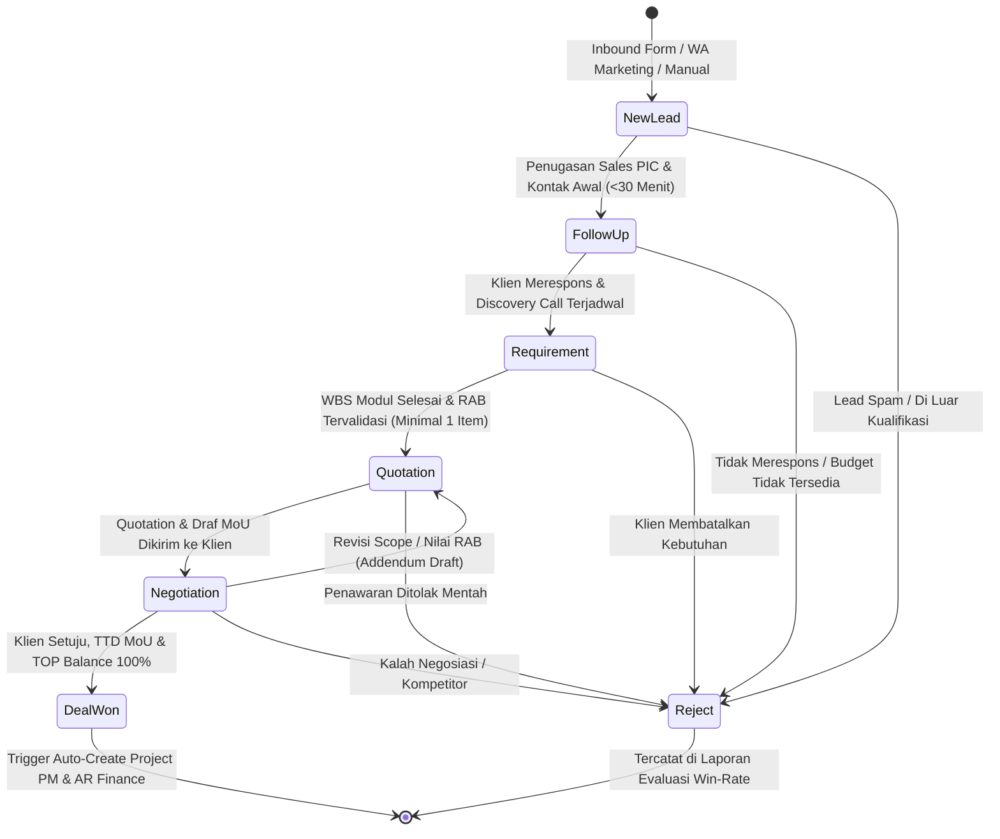
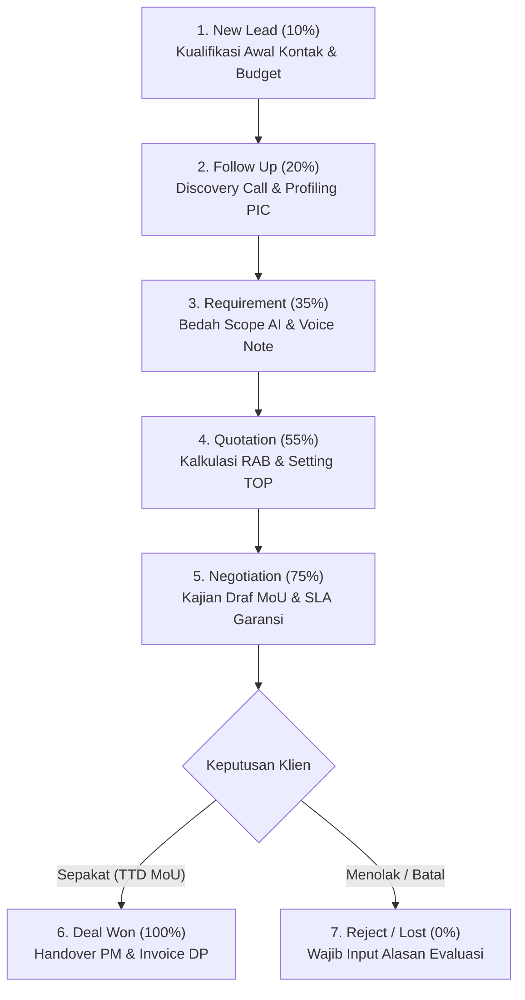
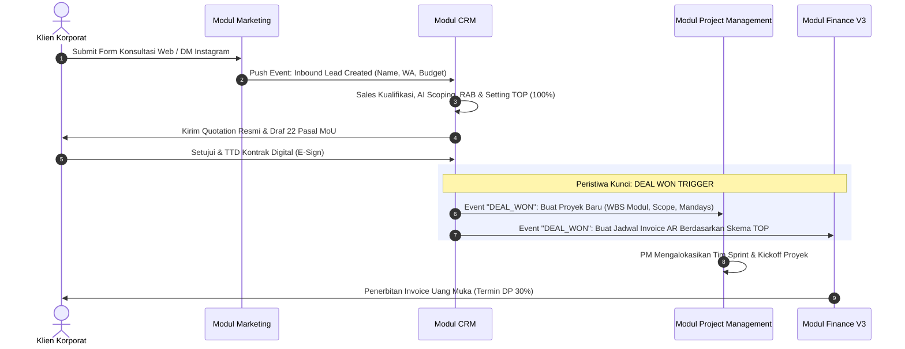

# PRODUCT REQUIREMENTS DOCUMENT (PRD)
# MODUL CRM (CUSTOMER RELATIONSHIP MANAGEMENT)
## ASTACODE ERP — UNIFIED ENTERPRISE OPERATIONS PLATFORM

| Dokumen Kontrol | Detail Spesifikasi |
|---|---|
| **Judul Dokumen** | Product Requirements Document (PRD) — Modul CRM |
| **Produk** | Astacode ERP — Enterprise CRM Suite |
| **Versi Dokumen** | 2.0 (Spesifikasi Teknis & Bisnis Lengkap) |
| **Status Dokumen** | Approved & Ready for Development / Implementation |
| **Penulis / Arsitek** | Head of ERP Architecture & Lead Product Manager |
| **Pemilik Produk** | PT ASTACODE Solusindo Teknologi |
| **Target Pengguna** | Sales Account Executive, Presales Engineer, Project Manager, Finance AR, Legal Counsel, Eksekutif |
| **File Terkait Kode** | `crm/index.html`, `crm/js/main.js`, `crm/js/components/*`, `crm/js/store/*`, `crm/js/utils/*` |

---

## DAFTAR ISI
1. [Ringkasan Eksekutif & Visi Modul](#1-ringkasan-eksekutif--visi-modul)
2. [Latar Belakang & Masalah Bisnis Software House](#2-latar-belakang--masalah-bisnis-software-house)
3. [Profil Pengguna & Matriks Hak Akses (RBAC)](#3-profil-pengguna--matriks-hak-akses-rbac)
4. [Arsitektur Informasi & Navigasi Modul](#4-arsitektur-informasi--navigasi-modul)
5. [Alur Bisnis & Workflow Pipeline End-to-End](#5-alur-bisnis--workflow-pipeline-end-to-end)
   - 5.1 [Diagram Alir Transisi State (State Machine)](#51-diagram-alir-transisi-state-state-machine)
   - 5.2 [Detail Tahapan 7-Stage Sales Pipeline](#52-detail-tahapan-7-stage-sales-pipeline)
   - 5.3 [Aturan Transisi & Kriteria Lolos (Gating Rules)](#53-aturan-transisi--kriteria-lolos-gating-rules)
6. [Spesifikasi Fungsional Rinci (Functional Requirements)](#6-spesifikasi-fungsional-rinci-functional-requirements)
   - 6.1 [FR-CRM-01: Registrasi & Manajemen Prospek (New Lead Modal)](#61-fr-crm-01-registrasi--manajemen-prospek-new-lead-modal)
   - 6.2 [FR-CRM-02: Voice Note Recorder & AI Transcriber Presales](#62-fr-crm-02-voice-note-recorder--ai-transcriber-presales)
   - 6.3 [FR-CRM-03: AI Requirement Scoping & WBS Generator](#63-fr-crm-03-ai-requirement-scoping--wbs-generator)
   - 6.4 [FR-CRM-04: Kalkulator RAB & Simulasi Gross Margin (Dual-View)](#64-fr-crm-04-kalkulator-rab--simulasi-gross-margin-dual-view)
   - 6.5 [FR-CRM-05: Setting TOP (Term of Payment) & Generator Terbilang](#65-fr-crm-05-setting-top-term-of-payment--generator-terbilang)
   - 6.6 [FR-CRM-06: Quotation Studio & Dokumen 4-Part Generator A4](#66-fr-crm-06-quotation-studio--dokumen-4-part-generator-a4)
   - 6.7 [FR-CRM-07: Master Customer 360° & Multi-Stakeholder Matrix](#67-fr-crm-07-master-customer-360--multi-stakeholder-matrix)
   - 6.8 [FR-CRM-08: Omnichannel WhatsApp Inbound Client Care](#68-fr-crm-08-omnichannel-whatsapp-inbound-client-care)
   - 6.9 [FR-CRM-09: Executive Reports & Revenue Forecast AI Engine](#69-fr-crm-09-executive-reports--revenue-forecast-ai-engine)
7. [Standardisasi 22 Klausul Hukum Perjanjian (MoU Legal Studio)](#7-standardisasi-22-klausul-hukum-perjanjian-mou-legal-studio)
8. [Struktur Skema Basis Data (Data Dictionary)](#8-struktur-skema-basis-data-data-dictionary)
9. [Jembatan Integrasi Antar-Modul (Cross-Module Bridges)](#9-jembatan-integrasi-antar-modul-cross-module-bridges)
10. [Kebutuhan Non-Fungsional (NFR)](#10-kebutuhan-non-fungsional-nfr)
11. [Kriteria Penerimaan Pengujian (Acceptance Criteria / BDD)](#11-kriteria-penerimaan-pengujian-acceptance-criteria--bdd)

---

## 1. RINGKASAN EKSEKUTIF & VISI MODUL

Modul CRM Astacode ERP dirancang sebagai pusat komando operasional komersial (*commercial operating system*) khusus untuk model bisnis penyedia jasa rekayasa perangkat lunak (*software house / IT consulting*). 

Berbeda dengan CRM ritel atau e-commerce biasa, penjualan solusi software kustom memiliki karakteristik unik:
* Siklus penjualan panjang (*long sales cycle: 2 hingga 12 minggu*).
* Nilai kontrak bernilai tinggi (*high-ticket B2B: puluhan hingga ratusan juta rupiah*).
* Negosiasi melibatkan aspek teknis arsitektur (*Work Breakdown Structure / WBS*), alokasi kapasitas engineer (*mandays*), margin laba kotor tim, termin pembayaran bertahap (*Term of Payment / TOP*), serta klausul hukum perikatan (*MoU/PKS/NDA*).

### Visi Modul
> *"Menghilangkan kesenjangan komunikasi antara janji komersial Sales dengan kapasitas teknis Engineering dan disiplin arus kas Finance melalui otomatisasi scoping bertenaga AI, kalkulasi RAB transparan, dan perikatan hukum yang terikat kontrak secara sah."*

---

## 2. LATAR BELAKANG & MASALAH BISNIS SOFTWARE HOUSE

| No | Masalah Operasional Konvensional (AS-IS) | Dampak Bisnis Negatif | Solusi Terpadu Astacode CRM (TO-BE) |
|:--:|---|---|---|
| **1** | Estimasi biaya proyek dihitung secara intuitif tanpa acuan rate card mandays yang baku. | Terjadi *underpricing* (rugi margin kotor) atau *overpricing* (kalah bersaing di pasar). | **Kalkulator RAB Baku & Dual-View Mode**: Menghitung mandays per role secara transparan dengan simulasi margin kotor dan proteksi kontingensi risiko. |
| **2** | Notulen meeting teknis tercecer di chat WhatsApp dan voice note yang tidak terdokumentasi. | Scope creep tidak terkendali; fitur bertambah di tengah jalan tanpa kompensasi biaya. | **AI Presales Transcriber & Scope Extractor**: Mentranskripsi voice note / brief meeting langsung menjadi modul WBS terstruktur. |
| **3** | Pembuatan surat penawaran (Quotation) dan draf kontrak (MoU) memakan waktu 2–4 hari via Word/Excel manual. | Respon lambat membuat calon klien beralih ke vendor lain. | **1-Click 4-Part Document Studio**: Menghasilkan dokumen penawaran A4 profesional lengkap (Surat, RAB, 22 Pasal MoU, dan E-Signature) secara instan. |
| **4** | Skema termin pembayaran (DP, Termin Progres, UAT) tidak sinkron dengan modul Keuangan. | Invoice terlambat ditagih; *cash flow* macet karena penagihan tidak memiliki trigger syarat yang jelas. | **Balanced TOP Engine (100%)**: Skema pembayaran bertahap divalidasi presisi dan otomatis menjadi jadwal piutang (*AR Schedule*) di Finance saat deal disetujui. |
| **5** | Transisi dari tahap closing (*Deal Won*) ke pelaksanaan teknis (*Project Kickoff*) manual dan terputus. | Project Manager tidak mengetahui scope detail yang dijanjikan sales; terjadi miskomunikasi deliverable. | **Automated Project Provisioning**: Status Deal Won otomatis menginisiasi workspace proyek di Project Management beserta WBS modulnya. |

---

## 3. PROFIL PENGGUNA & MATRIKS HAK AKSES (RBAC)

Sistem CRM Astacode menerapkan pengendalian hak akses berbasis peran secara ketat (*Role-Based Access Control*):

| Role / Persona | Tanggung Jawab Utama | Hak Akses Utama CRM |
|---|---|---|
| **Super Admin / Director** | Monitoring pipeline global, forecast pendapatan, persetujuan diskon khusus. | Full Access (Create, Read, Update, Delete, Export, Override Stage, Approval Diskon > 15%). |
| **Sales PIC / AE (Account Executive)** | Prospeksi lead, kontak klien, negosiasi, follow up aktivitas, penyusunan Quotation awal. | CRUD pada Lead miliknya, Read Master Customer, Read Rate Card, Create Quotation & Activity. |
| **Presales / Solution Architect** | Bedah kebutuhan teknis, validasi mandays, analisis arsitektur, kalkulasi HPP internal. | Read/Update Requirement AI, Edit Item RAB, Review Teknis, Toggle View Internal Cost/Margin. |
| **Project Manager (PM)** | Verifikasi kesiapan delivery sebelum Deal Won disahkan, monitoring scope kontrak. | Read Lead Won, Review WBS Modul RAB, Read Detail Kontrak MoU & Target Closing. |
| **Finance AR Specialist** | Pengawasan termin penagihan, verifikasi NPWP, penerbitan invoice uang muka (DP). | Read Quotation, Setup/Approve Skema TOP, Manage Invoices, Verifikasi Pembayaran Termin. |
| **Legal Counsel** | Pengawasan klausul kontrak kerja sama, penanganan addendum, audit e-Meterai. | Full Access pada Submodul Contracts & Legal (22 Pasal MoU), Audit E-Sign Trail. |

### Matriks Otorisasi Fitur (CRUD)

| Fitur / Entitas | Super Admin | Sales PIC | Presales | PM | Finance | Legal |
|---|:---:|:---:|:---:|:---:|:---:|:---:|
| Buat & Edit Lead Baru | ✅ | ✅ | 👁️ | 👁️ | ❌ | ❌ |
| Jalankan AI Requirement & Voice Note | ✅ | ✅ | ✅ | 👁️ | ❌ | ❌ |
| Ubah Rate Card & Internal Cost RAB | ✅ | ❌ | ✅ | 👁️ | 👁️ | ❌ |
| Beri Diskon Proyek (> 10%) | ✅ | ❌ | ❌ | ❌ | 👁️ | ❌ |
| Ubah & Kunci Skema TOP (100%) | ✅ | ✅ | 👁️ | 👁️ | ✅ | 👁️ |
| Pindahkan Stage ke "Deal Won" | ✅ | ✅* | ❌ | 👁️ | 👁️ | ❌ |
| Edit 22 Klausul Hukum Standar MoU | ✅ | ❌ | ❌ | ❌ | ❌ | ✅ |
| Akses Dashboard Executive Reports | ✅ | 👁️ (Own) | ❌ | 👁️ (Delivery) | ✅ | ❌ |

*\*Hanya dapat dieksekusi jika seluruh validasi bisnis (RAB tervalidasi dan TOP 100% balance) terpenuhi.*

---

## 4. ARSITEKTUR INFORMASI & NAVIGASI MODUL

Aplikasi CRM Astacode mengadopsi pola *Modular Single Page Application (SPA)* yang tertanam rapi pada antarmuka ERP dengan arsitektur navigasi berikut:

```
ASTACODE CRM SUITE
│
├── 1. PIPELINE WORKSPACE (crm/index.html#pipeline)
│    ├── View: Kanban Board (Drag-and-Drop 7 Stage)
│    ├── View: Pipeline Data Table (Multi-Filter & Pagination)
│    └── View: Pipeline Visual Workflow Tracker (Linear Stage Progress)
│
├── 2. LEAD DETAIL STUDIO (crm/index.html#lead_detail&id={lead_id})
│    ├── Tab 1: Overview (AI Presales Assistant, Next Best Action, KPI Summary)
│    ├── Tab 2: Activity & Meet (Timeline Interaksi, Google Meet, Call, Visit)
│    ├── Tab 3: Files & Stage Docs (Repository Dokumen per Tahapan)
│    ├── Tab 4: ✨ Requirement AI (Prompt Scoping, WBS Modul Breakdown)
│    ├── Tab 5: RAB / Mandays (Spreadsheet Biaya, Margin %, Dual-View Internal/Client)
│    ├── Tab 6: Quotation & TOP Studio (Setting Termin 100%, 4-Part A4 Preview, MoU)
│    ├── Tab 7: Kontak & Stakeholder (Multi-PIC: Decision Maker, Tech, Finance)
│    ├── Tab 8: Voice Notes & Dokumen AI (Audio Recording, Transcript, Action Items)
│    └── Tab 9: Audit Timeline (Log Perubahan Stage, Nilai, dan Aktor)
│
├── 3. MASTER CUSTOMER 360° (crm/index.html#customers)
│    ├── Direktori Pelanggan Korporat (Legal Name, NPWP, Alamat, Health Score)
│    └── Profil Stakeholder & Histori Kontrak Terdahulu
│
├── 4. PROJECT TRANSITION HUB (crm/index.html#projects)
│    └── Monitor Proyek Transisi Hasil Deal Won ke Modul PM
│
├── 5. FINANCE SETTING TOP & INVOICING (crm/index.html#finance_top)
│    ├── Kalender Penagihan Termin Piutang (AR Milestones)
│    └── Status Faktur (Draft, Sent, Paid, Overdue)
│
├── 6. KONTRAK & LEGALITAS MOU (crm/index.html#contracts_legal)
│    ├── Manajemen 22 Pasal Standar Perjanjian Kerjasama Software House
│    ├── Generator Addendum Perubahan Ruang Lingkup (Change Request)
│    └── Log Pengesahan E-Signature & E-Meterai (UU ITE No. 1/2024)
│
├── 7. CLIENT CARE & WHATSAPP (crm/index.html#client_care)
│    └── Omnichannel Chat WhatsApp Web Interaktif & Sinkronisasi Timeline
│
└── 8. EXECUTIVE REPORTS & FORECASTING (crm/index.html#reports)
     ├── Revenue Forecast AI (Weighted Pipeline vs Unweighted)
     ├── Win-Rate Analytics & Lead Source Attribution
     └── Deteksi Stale Leads (Lead Mandek ≥ 5 Hari)
```

---

## 5. ALUR BISNIS & WORKFLOW PIPELINE END-TO-END

### 5.1 Diagram Alir Transisi State (State Machine)



---

### 5.2 Detail Tahapan 7-Stage Sales Pipeline



| No | Tahap Pipeline | Bobot Win | Definisi Operasional | Aktivitas Wajib Sales PIC | Output Wajib Sistem |
|:--:|---|:--:|---|---|---|
| **1** | **New Lead** | 10% | Prospek mentah baru masuk dari kanal akuisisi (Website, WA, Ads, Referral). | Memverifikasi nomor WhatsApp/Email aktif dan mengidentifikasi industri serta skala perusahaan. | Entitas record `lead` baru berstatus `new_lead`. |
| **2** | **Follow Up** | 20% | Kontak pertama telah berhasil dilakukan; prospek menunjukkan ketertarikan. | Melakukan *discovery call*, menentukan jadwal meeting presentasi/survey lapangan, profiling pemegang keputusan. | Jadwal aktivitas meeting (`activity`) pada timeline; status kontak terkualifikasi. |
| **3** | **Requirement** | 35% | Penggalian spesifikasi teknis dan batasan masalah sistem klien. | Menerima brief/TOR/RFP atau merekam diskusi teknis; mengekstrak modul WBS via AI Presales. | Daftar breakdown modul fungsional & estimasi kebutuhan awal mandays tim engineer. |
| **4** | **Quotation** | 55% | Penyusunan rencana anggaran biaya detail dan skema pembayaran. | Menentukan rate card role developer, menghitung kontingensi, diskon, margin profit, dan menyusun termin TOP (100%). | Ringkasan RAB tervalidasi (`rab_summary`) dan draf skema termin (`top_scheme`). |
| **5** | **Negotiation** | 75% | Penawaran resmi (Quotation A4) dan draf klausul MoU telah diajukan ke klien. | Membahas klausul garansi, SLA dukungan teknis, negosiasi termin uang muka (DP), dan penyesuaian harga. | Dokumen resmi terkirim (`quotation` status: *Sent / Negosiasi*); histori revisi draf. |
| **6** | **Deal (Won)** | 100% | Klien menandatangani MoU / menyetujui penawaran harga final secara sah. | Konfirmasi tanda tangan kontrak digital, serah terima berkas administratif ke Project Manager & Finance. | **Auto-Trigger**: Proyek baru di PM + entitas Master Customer + jadwal invoice di Finance. |
| **7** | **Reject (Lost)**| 0% | Peluang batal, klien memilih kompetitor, atau proyek dipending. | Mendokumentasikan masukan klien mengenai alasan kegagalan closing dan mengevaluasi HPP penawaran. | Alasan reject wajib terdata (`reject_reason`), dimasukkan ke kampanye nurturing. |

---

### 5.3 Aturan Transisi & Kriteria Lolos (Gating Rules)

Untuk menjaga integritas data operasional, sistem secara terprogram menerapkan aturan validasi berikut (`pipelineRules.js`):

```javascript
// Cuplikan Logika Validasi Bisnis (BR-04, BR-07, BR-08, BR-15)
if (targetStageId === 'quotation') {
  if (!lead.rab || lead.rab.items.length === 0) {
    throw new Error('Tahap Quotation memerlukan estimasi RAB yang sudah dibuat (minimal 1 item modul).');
  }
}

if (targetStageId === 'deal') {
  if (!lead.rab || lead.rab.items.length === 0) {
    throw new Error('Tidak dapat Deal tanpa RAB yang valid dan disepakati.');
  }
  const activeQuo = lead.quotations.find(q => q.id === lead.active_quotation_id);
  if (!activeQuo || !activeQuo.top_scheme.is_balanced) {
    throw new Error('Termin pembayaran (Setting TOP) pada Quotation belum balance (100%). Selesaikan alokasi termin.');
  }
}

if (targetStageId === 'reject') {
  if (!rejectReason || rejectReason.trim().length === 0) {
    throw new Error('Perpindahan ke status Reject wajib menyertakan alasan penolakan.');
  }
}
```

* **Indikator Stale Leads**: Jika sebuah lead berada pada tahap yang sama selama $\ge 5\text{ hari}$ tanpa ada pembaruan aktivitas, kartu kanban akan ditandai dengan badge peringatan merah (*Stale Warning*) dan memicu notifikasi peringatan ke Sales PIC.

---

## 6. SPESIFIKASI FUNGSIONAL RINCI (FUNCTIONAL REQUIREMENTS)

### 6.1 FR-CRM-01: Registrasi & Manajemen Prospek (New Lead Modal)

* **Deskripsi**: Formulir komprehensif untuk mendaftarkan prospek baru baik dari klien yang sudah ada (*existing customer*) maupun pendaftaran badan usaha baru.
* **Input Data**:
  - `title`: Judul kebutuhan proyek (contoh: *Aplikasi HRD 500 Karyawan & Mobile ESS*).
  - `project_type`: Pilihan kategori (*Web & Mobile App, ERP Custom, Fintech, IoT & Telematics, E-Commerce, Lainnya*).
  - `est_value`: Nilai estimasi kasar awal (Rupiah).
  - `target_closing`: Tanggal target closing deal (YYYY-MM-DD).
  - `priority`: Tingkat urgensi (*Hot, High, Medium, Low*).
  - `sales_pic`: Penanggung jawab sales (dropdown user internal).
  - `source` & `sub_source`: Sumber akuisisi (*Instagram DM, Website Form, WhatsApp Inbound, LinkedIn Outreach, Referral, Meta Ads, Event*).
  - `customerMode`: Toggle *Existing Customer* (pilih dari database) vs *New Customer* (input nama PT, industri, skala karyawan, alamat, NPWP, dan PIC primer).
* **Validasi**:
  - Judul proyek, nama PIC, nomor WhatsApp, dan nilai estimasi wajib diisi.
  - Format nomor WhatsApp otomatis dinormalisasi ke standar internasional (`+628...`).

---

### 6.2 FR-CRM-02: Voice Note Recorder & AI Transcriber Presales

* **Deskripsi**: Kemampuan merekam obrolan langsung saat meeting atau mengunggah rekaman suara (*audio file: .mp3, .wav, .m4a*), yang kemudian diproses oleh mesin AI untuk mengekstrak intisari teknis presales.
* **Alur Pemrosesan AI**:
  1. **Audio Recording**: Audio direkam via browser (Web Audio API) dengan timer durasi realtime.
  2. **Transcription Engine**: Audio diubah menjadi teks percakapan akurat dalam Bahasa Indonesia.
  3. **Structured Entity Extraction**: AI memilah teks menjadi:
     - **Executive Summary**: Rangkuman latar belakang masalah klien.
     - **Client Core Needs**: 3–5 poin kebutuhan esensial yang diminta klien.
     - **Technical Scope**: Rekomendasi modul WBS beserta estimasi mandays awal.
     - **Action Items**: Daftar tugas tindak lanjut lengkap dengan penanggung jawab (*PIC*) dan batas waktu (*due date*).
* **Integrasi**: Action item hasil AI dapat disinkronkan langsung ke tabel agenda aktivitas (`activities`) hanya dengan satu klik.

---

### 6.3 FR-CRM-03: AI Requirement Scoping & WBS Generator

* **Deskripsi**: Modul intelejen perancang arsitektur perangkat lunak yang mengubah dokumen brief (RFP/TOR) atau instruksi teks bebas menjadi struktur rincian modul kerja (*Work Breakdown Structure*).
* **Komponen WBS yang Dihasilkan**:
  - Kategori Modul: *Frontend UI/UX, Backend Core & Database, Integrasi API / Payment Gateway, Mobile Application, DevOps & Cloud Security, QA Testing & UAT Support*.
  - Detail Fitur: Deskripsi spesifik perilaku sistem per modul.
  - Estimasi Mandays Rekomendasi: Alokasi hari kerja programmer yang realistis.
  - Rekomendasi Tech Stack: Pilihan arsitektur yang disarankan (contoh: *Next.js 14, Laravel 11, PostgreSQL, Docker*).

---

### 6.4 FR-CRM-04: Kalkulator RAB & Simulasi Gross Margin (Dual-View)

* **Deskripsi**: Spreadsheet interaktif penyusun anggaran biaya proyek yang menjembatani harga jual ke klien dengan estimasi biaya produksi internal tim engineer.
* **Formula Komputasi Baku**:

$$\text{Subtotal Tagihan} = \sum (\text{Qty Mandays}_i \times \text{Rate Jual Satuan}_i)$$

$$\text{HPP Internal (Cost)} = \sum (\text{Qty Mandays}_i \times \text{Unit Cost Internal}_i)$$

$$\text{Kontingensi Risiko} = \text{Subtotal Tagihan} \times \frac{\text{Contingency \%}}{100}$$

$$\text{Total Sebelum Pajak} = \text{Subtotal Tagihan} + \text{Kontingensi Risiko} - \text{Diskon}$$

$$\text{PPN 11\%} = \text{Total Sebelum Pajak} \times 0.11$$

$$\text{Grand Total Penawaran} = \text{Total Sebelum Pajak} + \text{PPN 11\%}$$

$$\text{Gross Margin \%} = \frac{\text{Total Sebelum Pajak} - \text{HPP Internal}}{\text{Total Sebelum Pajak}} \times 100\%$$

* **Spesifikasi Dual-View**:
  - **Internal View (Protected Role)**: Menampilkan kolom *Unit Cost internal*, total estimasi pengeluaran gaji programmer, dan badge indikator kesehatan margin laba kotor (Warna Hijau jika $\ge 40\%$, Kuning jika $25-39\%$, Merah jika $< 25\%$).
  - **Client View (Safe Presentation Mode)**: Kolom rate satuan dan HPP internal disembunyikan. Yang disajikan ke klien hanya nama modul, spesifikasi fungsional, mandays kerja, serta ringkasan total investasi akhir.

---

### 6.5 FR-CRM-05: Setting TOP (Term of Payment) & Generator Terbilang

* **Deskripsi**: Modul pengaturan jadwal termin pembayaran berbasis pencapaian tonggak kerja (*milestone*).
* **Pilihan Preset Skema Pembayaran**:
  - **Preset 30 / 40 / 30**: Uang Muka DP 30% $\rightarrow$ Selesai Backend/Frontend Staging 40% $\rightarrow$ UAT & BAST 30%.
  - **Preset 50 / 50**: DP 50% $\rightarrow$ Serah Terima Pekerjaan 50%.
  - **Preset 20 / 30 / 30 / 20**: DP 20% $\rightarrow$ Prototype UI/UX 30% $\rightarrow$ Staging Demo 30% $\rightarrow$ Go-Live & Retensi 20%.
  - **Custom Scheme**: Konfigurasi mandiri dengan jumlah termin tak terbatas.
* **Logika Validasi Balance**:

$$\sum_{k=1}^{n} \text{Persentase Termin}_k \equiv 100.00\%$$

*Jika alokasi termin $\ne 100\%$, tombol simpan dan ekspor dokumen terkunci secara otomatis disertai peringatan selisih nilai.*
* **Fungsi Terbilang Otomatis**: Mengonversi setiap nilai angka termin menjadi kalimat representasi Bahasa Indonesia resmi (contoh: `Rp92.966.940` $\rightarrow$ *"Sembilan Puluh Dua Juta Sembilan Ratus Enam Puluh Enam Ribu Sembilan Ratus Empat Puluh Rupiah"*).

---

### 6.6 FR-CRM-06: Quotation Studio & Dokumen 4-Part Generator A4

* **Deskripsi**: Mesin pembuat berkas penawaran dan kontrak legal standar industri yang siap dicetak (*A4 Print-Ready*) atau diunduh dalam format PDF resmi dengan 4 bagian terpadu:
  1. **Bagian I — Surat Pengantar Resmi (Executive Cover Letter)**: Memuat nomor quotation (`QT/YYYY/MM/XXXX`), profil PT Astacode Solusindo Teknologi, latar belakang solusi, dan batas masa berlaku penawaran (default: 30 hari kalender).
  2. **Bagian II — Rincian Anggaran Biaya (RAB WBS Table)**: Menampilkan tabel modul terstruktur, rincian hari kerja (*mandays*), rekap kontingensi, PPN 11%, dan skema termin pembayaran (*TOP*).
  3. **Bagian III — Klausul Perjanjian Kerjasama (MoU Clauses)**: Memuat 22 pasal hukum baku yang melindungi hak cipta software, batasan garansi, dan kerahasiaan data (NDA).
  4. **Bagian IV — Lembar Pengesahan Para Pihak (Signature & E-Meterai Sheet)**: Kolom tanda tangan digital / basah perwakilan resmi kedua belah pihak dengan alokasi stempel e-Meterai resmi sesuai UU ITE No. 1/2024.

---

### 6.7 FR-CRM-07: Master Customer 360° & Multi-Stakeholder Matrix

* **Deskripsi**: Basis data terpusat pelanggan korporat yang memetakan seluruh entitas bisnis, legalitas hukum, dan struktur pemangku kepentingan.
* **Struktur Data Master Customer**:
  - Informasi Legal: Nama Terdaftar PT/CV, Nama Brand Komersial, Alamat Kantor, NPWP (format 16 digit), Sektor Industri, Skala Perusahaan.
  - Parameter Kesehatan Klien (*Health Score: 0–100*): Dihitung dari riwayat ketepatan pembayaran invoice termin dan frekuensi transaksi ulang (*repeat project*).
  - Pemetaan Stakeholder (*Multi-PIC Mapping*):
    - **Decision Maker**: Direktur / Head of Dept yang memiliki kuasa otorisasi anggaran dan penandatanganan kontrak.
    - **Technical Lead**: PIC pengembang/IT internal klien yang bertindak sebagai penguji teknis saat UAT.
    - **Finance Lead**: Bagian keuangan klien yang bertanggung jawab atas pencairan dana dan penyerahan bukti potong pajak PPh 23.

---

### 6.8 FR-CRM-08: Omnichannel WhatsApp Inbound Client Care

* **Deskripsi**: Antarmuka interaksi langsung dengan klien berbasis WhatsApp Web yang terintegrasi di dalam CRM.
* **Fitur Utama**:
  - Kotak Masuk Percakapan: Menampilkan riwayat percakapan klien tanpa perlu membuka gawai ponsel terpisah.
  - Auto-Log ke Timeline Lead: Setiap percakapan penting atau kesepakatan via chat dapat disematkan (*pinned*) langsung ke histori timeline lead.
  - Template Pesan Cepat (*Canned Responses*): Tersedia template chat siap pakai untuk follow up penawaran, pengingat meeting UAT, dan notifikasi penerbitan invoice termin.

---

### 6.9 FR-CRM-09: Executive Reports & Revenue Forecast AI Engine

* **Deskripsi**: Dasbor analitik eksekutif untuk memprediksi proyeksi pendapatan kas masuk (*revenue forecasting*) dan mengukur efisiensi kerja tim sales.
* **Metrik Utama**:
  - **Weighted Pipeline Value**: Total nilai proyek dikalikan probabilitas masing-masing tahap pipeline:

$$\text{Weighted Forecast} = \sum (\text{Lead Value}_j \times \text{Probability Stage}_j)$$

  - **Sales Win-Rate Ratio**: Persentase rasio keberhasilan closing deal:

$$\text{Win Rate \%} = \frac{\text{Jumlah Lead Deal Won}}{\text{Total Lead (Deal Won + Reject)}} \times 100\%$$

  - **Lead Source Attribution**: Analisis saluran akuisisi pemasaran mana yang menghasilkan konversi tertinggi (Instagram vs Website vs Referral vs Ads).
  - **Average Sales Cycle**: Rata-rata durasi waktu yang dibutuhkan dari tahap *New Lead* hingga *Deal Won*.

---

## 7. STANDARDISASI 22 KLAUSUL HUKUM PERJANJIAN (MOU LEGAL STUDIO)

Setiap dokumen penawaran resmi yang diterbitkan oleh sistem CRM Astacode secara otomatis menyertakan 22 pasal hukum terstandarisasi untuk melindungi aset intelektual dan memitigasi sengketa operasional:

| No | Nomor Pasal | Judul Klausul | Intisari Hukum & Batasan Tanggung Jawab |
|:--:|---|---|---|
| 1 | **Pasal 1** | Ketentuan Umum & Definisi | Mendefinisikan istilah "Pekerjaan", batasan sistem, PIHAK PERTAMA (Klien), dan PIHAK KEDUA (PT Astacode Solusindo Teknologi). |
| 2 | **Pasal 2** | Maksud, Tujuan & Penunjukan | Menegaskan penunjukan resmi Astacode sebagai mitra penyedia jasa teknologi eksklusif pelaksanaan proyek. |
| 3 | **Pasal 3** | Ruang Lingkup & Deliverable | Mengunci ruang lingkup sistem hanya pada modul-modul yang tertera pada Lampiran RAB WBS terlampir. |
| 4 | **Pasal 4** | Metodologi Pengembangan | Penerapan metodologi Agile Scrum dengan laporan berkala sprint demo mingguan kepada Product Owner klien. |
| 5 | **Pasal 5** | Jangka Waktu & Masa Efektif | Kontrak berlaku efektif sejak ditandatangani dan pelunasan pembayaran Down Payment (DP) diterima lunas. |
| 6 | **Pasal 6** | Nilai Kontrak & Termin (TOP) | Kewajiban mematuhi skema pembayaran bertahap dengan masa jatuh tempo invoice maksimal 14 hari kalender. |
| 7 | **Pasal 7** | Ketentuan Perpajakan | Pengenaan PPN 11% sesuai perundang-undangan dan kewajiban klien menyerahkan bukti potong PPh 23 (e-Bupot). |
| 8 | **Pasal 8** | Prosedur Pengujian & UAT | Batas waktu User Acceptance Testing maksimal 14 hari kerja di staging server sebelum penandatanganan Berita Acara UAT. |
| 9 | **Pasal 9** | Serah Terima & BAST | Penandatanganan Berita Acara Serah Terima (BAST) resmi sebagai syarat deployment sistem ke server produksi (Go-Live). |
| 10 | **Pasal 10** | Ketentuan Change Request (CR) | Penambahan fitur di luar RAB wajib diajukan tertulis dan dikenakan biaya mandays tambahan via Addendum Kontrak. |
| 11 | **Pasal 11** | Hak Cipta & Source Code Escrow | Hak cipta source code kustom diserahkan ke klien setelah lunas 100%; framework inti internal tetap milik Astacode. |
| 12 | **Pasal 12** | Kerahasiaan Informasi (NDA) | Kewajiban menjaga rahasia dagang, data bisnis, dan arsitektur teknis para pihak hingga 3 tahun pasca kontrak selesai. |
| 13 | **Pasal 13** | Kepatuhan UU PDP No. 27/2022 | Komitmen kepatuhan Pelindungan Data Pribadi: Astacode sebagai pemroses data wajib menerapkan enkripsi data end-to-end. |
| 14 | **Pasal 14** | Garansi Pemeliharaan Bug | Garansi bebas cacat program (*bug-free warranty*) secara gratis selama 90 hari kalender sejak penandatanganan BAST. |
| 15 | **Pasal 15** | SLA Dukungan Helpdesk | Service Level Agreement respon kendala jam kerja: Insiden Kritis (P1) < 1 jam, Mayor (P2) < 4 jam, Normal (P3) < 24 jam. |
| 16 | **Pasal 16** | Keamanan Siber & Audit VAPT | Sistem dibangun mengacu standar OWASP Top 10; klien berhak melakukan uji penetrasi (*pentest*) sebelum Go-Live. |
| 17 | **Pasal 17** | Server & Cloud Deployment | Penyediaan biaya server produksi/cloud (AWS/GCP) ditanggung klien; Astacode mengelola pipeline deployment CI/CD. |
| 18 | **Pasal 18** | Keadaan Kahar (Force Majeure) | Pembebasan tanggung jawab hukum jika terjadi bencana alam, perang, kebakaran hebat, atau regulasi moneter darurat. |
| 19 | **Pasal 19** | Sanksi Keterlambatan & Denda | Denda keterlambatan penyelesaian atau pembayaran sebesar 1‰ (satu permil) per hari, dengan batas maksimal penalti 5%. |
| 20 | **Pasal 20** | Pengakhiran Perjanjian | Ketentuan pemutusan kontrak sepihak jika terjadi cidera janji material setelah masa peringatan tertulis 14 hari. |
| 21 | **Pasal 21** | Penyelesaian Sengketa | Mengutamakan asas musyawarah mufakat (30 hari); jika gagal diselesaikan melalui Pengadilan Negeri domisili penyedia. |
| 22 | **Pasal 22** | Keabsahan E-Sign UU ITE | Pengesahan keabsahan tanda tangan elektronik tersertifikasi dan e-Meterai resmi sesuai UU ITE No. 1 Tahun 2024. |

---

## 8. STRUKTUR SKEMA BASIS DATA (DATA DICTIONARY)

Berikut adalah entitas data relasional utama yang menopang seluruh operasi modul CRM:

```
┌─────────────────┐       1:N       ┌────────────────────────┐
│    customers    ├─────────────────┤   customer_contacts    │
└────────┬────────┘                 └────────────────────────┘
         │ 1:N
         ▼
┌─────────────────┐       1:N       ┌────────────────────────┐
│      leads      ├─────────────────┤       activities       │
└────────┬────────┘                 └────────────────────────┘
         │ 1:1
         ▼
┌─────────────────┐       1:N       ┌────────────────────────┐
│      rabs       ├─────────────────┤       rab_items        │
└────────┬────────┘                 └────────────────────────┘
         │ 1:N
         ▼
┌─────────────────┐       1:1       ┌────────────────────────┐
│   quotations    ├─────────────────┤      top_schemes       │
└────────┬────────┘                 └───────────┬────────────┘
         │                                      │ 1:N
         │ (Saat Deal Won)                      ▼
         ▼                          ┌────────────────────────┐
┌─────────────────┐                 │     top_milestones     │
│  projects (PM)  │                 └────────────────────────┘
└─────────────────┘
```

### Kamus Kolom Kunci Entitas

#### 1. Tabel `leads`
| Kolom | Tipe Data | Keterangan |
|---|---|---|
| `id` | VARCHAR(36) [PK] | Pengenal unik lead (UUID). |
| `code` | VARCHAR(20) [UNIQUE] | Kode registrasi resmi (misal: `LD-2026-001`). |
| `title` | VARCHAR(255) | Nama kebutuhan pengadaan sistem software klien. |
| `customer_id` | VARCHAR(36) [FK] | Relasi ke tabel `customers.id`. |
| `stage_id` | ENUM | Tahap: `new_lead`, `follow_up`, `requirement`, `quotation`, `negotiation`, `deal`, `reject`. |
| `est_value` | DECIMAL(15,2) | Nilai nominal proyek (Rupiah). |
| `target_closing`| DATE | Tanggal estimasi penutupan kontrak. |
| `sales_pic` | VARCHAR(100) | Nama penanggung jawab sales internal. |
| `priority` | ENUM('Hot','High','Medium','Low') | Prioritas prospek. |
| `source` | VARCHAR(50) | Saluran sumber akuisisi lead. |
| `days_in_stage` | INT | Jumlah hari lead berdiam di stage saat ini. |
| `active_quotation_id`| VARCHAR(36) [NULL] | Relasi ke quotation aktif terpilih. |
| `reject_reason`| TEXT [NULL] | Alasan penolakan jika stage berstatus `reject`. |

#### 2. Tabel `rabs` & `rab_items`
| Kolom | Tipe Data | Keterangan |
|---|---|---|
| `rab_id` | VARCHAR(36) [PK] | ID unik Rencana Anggaran Biaya. |
| `lead_id` | VARCHAR(36) [FK] | Relasi ke `leads.id`. |
| `version` | INT | Nomor revisi RAB (Rev. 1, Rev. 2, dst). |
| `subtotal` | DECIMAL(15,2) | Akumulasi total mandays × harga satuan. |
| `contingency_pct`| DECIMAL(5,2) | Persentase kontingensi risiko (default: 10.00). |
| `discount_amount`| DECIMAL(15,2) | Potongan harga komersial yang disetujui. |
| `tax_pct` | DECIMAL(5,2) | Nilai PPN (default: 11.00). |
| `grand_total` | DECIMAL(15,2) | Total nilai investasi akhir. |
| `internal_cost` | DECIMAL(15,2) | Total HPP biaya langsung tenaga kerja programmer. |
| `margin_pct` | DECIMAL(5,2) | Persentase margin kotor yang dihasilkan. |
| *`rab_items`* | Child Table | Menyimpan rincian item: `module_name`, `feature_spec`, `role`, `qty_mandays`, `unit_price`, `unit_cost`. |

#### 3. Tabel `top_schemes` & `top_milestones`
| Kolom | Tipe Data | Keterangan |
|---|---|---|
| `top_id` | VARCHAR(36) [PK] | ID unik skema termin. |
| `quotation_id` | VARCHAR(36) [FK] | Relasi ke `quotations.id`. |
| `preset_name` | VARCHAR(50) | Nama preset (misal: `30/40/30`, `50/50`, `Custom`). |
| `is_balanced` | BOOLEAN | Flag validasi total alokasi persentase $\equiv 100\%$. |
| *`top_milestones`*| Child Table | Rincian termin: `term_number`, `milestone_name`, `percentage`, `amount_idr`, `terbilang_text`, `trigger_condition`, `due_days_offset`. |

---

## 9. JEMBATAN INTEGRASI ANTAR-MODUL (CROSS-MODULE BRIDGES)



### Rincian Kontrak Data Lintas Modul:
1. **Marketing $\rightarrow$ CRM**:
   - Parameter: `lead_id`, `contact_name`, `company_name`, `whatsapp_number`, `channel_source`, `inquiry_text`.
   - Perilaku: Membentuk record prospek baru di tahapan *New Lead* dengan badge sumber akuisisi secara instan.
2. **CRM $\rightarrow$ Project Management (Forge PM)**:
   - Parameter: `project_id`, `client_id`, `deal_id`, `project_name`, `modules_wbs (JSON)`, `total_mandays`, `deadline_date`.
   - Perilaku: Menginisiasi repositori workspace proyek di modul PM; memecah item modul RAB menjadi daftar tugas backlog awal bagi engineer.
3. **CRM $\rightarrow$ Finance V3**:
   - Parameter: `client_id`, `deal_id`, `quotation_number`, `top_scheme_id`, `milestone_terms (JSON)`.
   - Perilaku: Mengisi kalender piutang (*Accounts Receivable / AR*) pada modul Keuangan; secara terjadwal menerbitkan draft faktur penagihan setiap kali trigger milestone disetujui.

---

## 10. KEBUTUHAN NON-FUNGSIONAL (NFR)

| Kategori | Spesifikasi Kebutuhan Non-Fungsional |
|---|---|
| **Performa Sistem** | Waktu render awal halaman pipeline Kanban < 1.2 detik (p95); proses kalkulasi formula spreadsheet RAB < 100 milidetik saat terjadi perubahan input data. |
| **Keamanan & Enkripsi** | Seluruh data kontak klien, nilai kontrak, dan transkrip notulen meeting dienkripsi pada saat diam (*at-rest via AES-256*) dan dalam transmisi (*in-transit via TLS 1.3*). |
| **Kepatuhan Privasi Data** | Memenuhi kaidah **UU Pelindungan Data Pribadi (UU PDP No. 27/2022)**: Data pribadi PIC klien hanya digunakan untuk kepentingan korespondensi proyek dan dapat diminta untuk dianonimkan jika kerjasama berakhir. |
| **Keabsahan Dokumen Hukum** | Format berkas PDF cetak A4 memiliki resolusi vektor tajam (300 DPI) dan siap dibubuhi stempel elektronik e-Meterai resmi yang memenuhi ketentuan Pasal 11 **UU ITE No. 1 Tahun 2024**. |
| **Auditability (Jejak Rekam)** | Seluruh pemindahan tahap pipeline, diskon yang diberikan, dan pergantian skema termin tersimpan permanen pada *immutable audit log* lengkap dengan ID pengguna dan cap waktu (*timestamp ISO-8601*). |
| **Offline-First Fallback** | Jika koneksi internet terputus sesaat, data draf input formulir tersimpan di `LocalStorage` browser sehingga pengguna tidak kehilangan draf penawaran yang sedang diketik. |

---

## 11. KRITERIA PENERIMAAN PENGUJIAN (ACCEPTANCE CRITERIA / BDD)

Berikut adalah skenario pengujian berbasis perilaku (*Behavior-Driven Development / BDD*) untuk memverifikasi kesiapan rilis fitur CRM:

### Skenario 1: Validasi Pemindahan Tahap ke Quotation Wajib Memiliki RAB
```gherkin
GIVEN pengguna berada pada halaman Pipeline Kanban CRM
AND memilih sebuah Lead yang belum memiliki data modul RAB
WHEN pengguna mencoba menggeser (drag-and-drop) kartu Lead tersebut ke kolom "Quotation"
THEN sistem membatalkan perpindahan kartu secara otomatis
AND menampilkan pesan toast peringatan: "Tahap Quotation memerlukan estimasi RAB yang sudah dibuat (minimal 1 item modul)."
AND status lead tetap berada pada tahapan sebelumnya.
```

### Skenario 2: Validasi Penutupan Deal Won Memerlukan Skema TOP 100%
```gherkin
GIVEN sebuah Lead berada pada tahap "Negotiation" dengan nilai RAB sebesar Rp300.000.000
AND konfigurasi termin pembayaran (Setting TOP) saat ini berjumlah 90% (DP 30% + Termin 1 60%)
WHEN Sales PIC menekan tombol aksi "Closing Deal (Won)"
THEN sistem menolak perubahan status
AND memunculkan dialog modal validasi keuangan: "Termin pembayaran pada Quotation belum balance (100%). Sisa alokasi yang belum diatur: 10% (Rp30.000.000)."
AND sistem melarang penerbitan kontrak sebelum skema termin mencapai tepat 100%.
```

### Skenario 3: Penolakan Lead (Reject) Mewajibkan Pengisian Alasan
```gherkin
GIVEN pengguna ingin memindahkan lead ke tahap "Reject (Lost)"
WHEN pengguna menekan opsi "Reject Lead"
THEN sistem menampilkan dialog modal konfirmasi pembatalan
AND tombol konfirmasi "Simpan Status Reject" berstatus disabled hingga pengguna memilih salah satu kategori alasan dan mengisi catatan evaluasi minimal 10 karakter.
```

### Skenario 4: Handover Otomatis Deal Won ke Modul PM & Finance
```gherkin
GIVEN sebuah Lead telah memiliki RAB valid dan skema termin TOP balance 100%
WHEN Super Admin atau Sales PIC mengesahkan status "Deal (Won)"
THEN sistem mengubah status lead menjadi "Deal" dengan warna hijau emerald (probabilitas 100%)
AND sistem secara otomatis membuat entitas proyek baru di modul Project Management
AND sistem mendaftarkan jadwal penagihan termin ke modul Finance V3
AND menampilkan pesan sukses: "Deal berhasil disahkan! Proyek baru dan jadwal invoice telah diterbitkan otomatis."
```

---
*Dokumen PRD CRM Versi 2.0 ini disahkan secara resmi sebagai acuan tunggal pengembangan sistem komersial operasional pada ekosistem Astacode ERP.*
