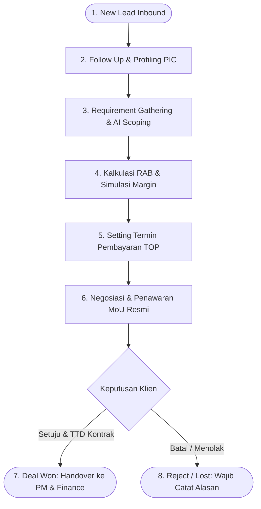
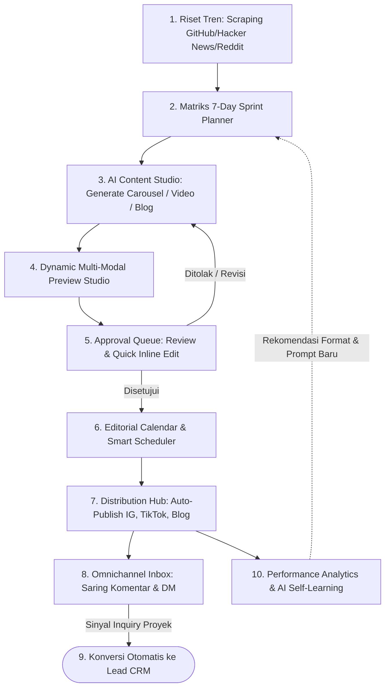
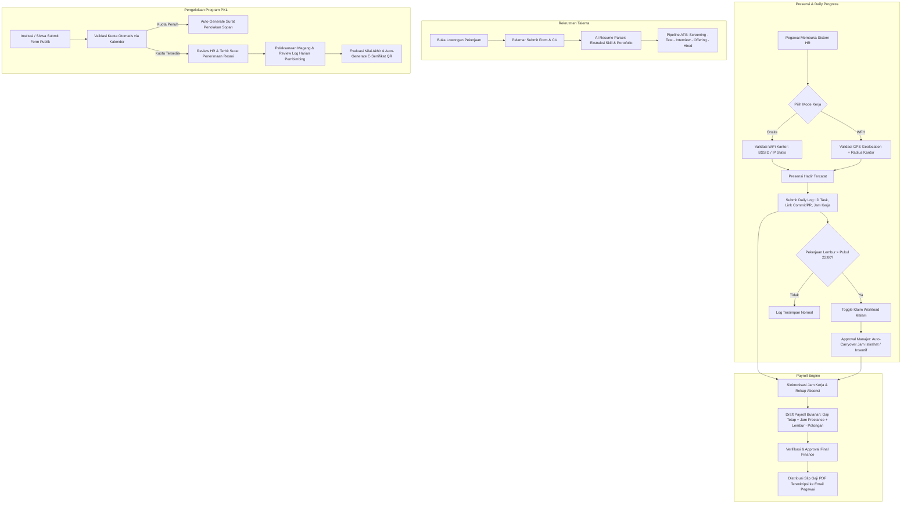

# RINGKASAN ARSITEKTUR BISNIS, WORKFLOW, DAN ALIRAN DATA
## MODUL CRM, MARKETING, DAN HRD — ASTACODE ERP

| Metadata | Keterangan |
|---|---|
| **Dokumen** | Ringkasan Analisis Proses Bisnis & Alur Data (Fondasi PRD) |
| **Platform** | Astacode ERP (Enterprise Operations Platform) |
| **Modul Terpilih** | CRM Suite, Marketing & AI Content Engine, HR & Workload Management |
| **Tujuan** | Dokumen acuan komprehensif untuk penyusunan Dokumen PRD Lengkap |
| **Versi Dokumen** | 1.0 (Berdasarkan Analisis Kode Sumber & Arsitektur Sistem) |
| **Status** | Siap Jadi Acuan Penyusunan PRD |

---

## DAFTAR ISI
1. [Peta Besar Ekosistem: Korelasi CRM, Marketing & HRD](#1-peta-besar-ekosistem-korelasi-crm-marketing--hrd)
2. [Modul CRM (Customer Relationship Management)](#2-modul-crm-customer-relationship-management)
   - 2.1 [Visi & Tujuan Bisnis](#21-visi--tujuan-bisnis)
   - 2.2 [Alur Bisnis Proses & Workflow End-to-End](#22-alur-bisnis-proses--workflow-end-to-end)
   - 2.3 [Aliran Data Masuk & Keluar (Data In & Data Out)](#23-aliran-data-masuk--keluar-data-in--data-out)
   - 2.4 [Fitur Inti & Spesifikasi Fungsional](#24-fitur-inti--spesifikasi-fungsional)
   - 2.5 [Aturan Bisnis & Validasi Sistem (Business Rules)](#25-aturan-bisnis--validasi-sistem-business-rules)
3. [Modul Marketing & AI Content Engine](#3-modul-marketing--ai-content-engine)
   - 3.1 [Visi & Tujuan Bisnis](#31-visi--tujuan-bisnis)
   - 3.2 [Alur Bisnis Proses & Workflow End-to-End](#32-alur-bisnis-proses--workflow-end-to-end)
   - 3.3 [Aliran Data Masuk & Keluar (Data In & Data Out)](#33-aliran-data-masuk--keluar-data-in--data-out)
   - 3.4 [Fitur Inti & Spesifikasi Fungsional](#34-fitur-inti--spesifikasi-fungsional)
   - 3.5 [Aturan Bisnis & Standar Format Konten](#35-aturan-bisnis--standar-format-konten)
4. [Modul HRD (Human Resources & Workload Management)](#4-modul-hrd-human-resources--workload-management)
   - 4.1 [Visi & Filosofi Bisnis](#41-visi--filosofi-bisnis)
   - 4.2 [Alur Bisnis Proses & Workflow End-to-End](#42-alur-bisnis-proses--workflow-end-to-end)
   - 4.3 [Aliran Data Masuk & Keluar (Data In & Data Out)](#43-aliran-data-masuk--keluar-data-in--data-out)
   - 4.4 [Fitur Inti & Spesifikasi Fungsional](#44-fitur-inti--spesifikasi-fungsional)
   - 4.5 [Aturan Bisnis, Regulasi & Penanganan Risiko](#45-aturan-bisnis-regulasi--penanganan-risiko)
5. [Matriks Integrasi Lintas Modul (Cross-Module Data Bridges)](#5-matriks-integrasi-lintas-modul-cross-module-data-bridges)
6. [Panduan Template Penyusunan PRD Lengkap](#6-panduan-template-penyusunan-prd-lengkap)

---

## 1. PETA BESAR EKOSISTEM: KORELASI CRM, MARKETING & HRD

Ketiga modul ini membentuk rantai nilai (*value chain*) utama operasional software house:
1. **Marketing** mengakuisisi perhatian audiens (*brand awareness & authority*), menyaring sinyal kebutuhan pembuatan software, dan menyalurkannya sebagai prospek hangat (*inbound leads*).
2. **CRM** memproses prospek tersebut melalui kualifikasi teknis, scoping otomatis berbasis AI, kalkulasi biaya & marjin (RAB), penjadwalan termin pembayaran (*TOP*), hingga penandatanganan MoU resmi (*Deal Won*).
3. **HRD** menyediakan dan mengelola kapasitas tenaga kerja (karyawan tetap, mitra freelance, siswa PKL), mencatat kehadiran berbasis progres kerja (*task-driven*), memfasilitasi lembur darurat (*Workload Malam*), dan mengeksekusi penggajian (*Payroll Engine*) berbasis output proyek.

```mermaid
flowchart LR
    subgraph MKT["1. MODUL MARKETING"]
        direction TB
        M1[Riset Tren & AI Content Studio] --> M2[Multi-Platform Publishing]
        M2 --> M3[Omnichannel Inbox: Komentar & DM]
    end

    subgraph CRM["2. MODUL CRM"]
        direction TB
        C1[Inbound Lead Terkualifikasi] --> C2[AI Scoping & Kalkulasi RAB]
        C2 --> C3[Quotation, Setting TOP & MoU]
        C3 --> C4[Deal Won: Pembuatan Proyek Baru]
    end

    subgraph HRD["3. MODUL HRD"]
        direction TB
        H1[Alokasi Engineer & Freelancer] --> H2[Daily Log Task & Workload Malam]
        H2 --> H3[Payroll Engine Multi-Tier]
    end

    M3 -- "Lead Handoff (Nama, Kontak, Minat)" --> C1
    C4 -- "Kebutuhan Kapasitas Tim (Mandays)" --> H1
    H2 -- "Log Jam Kerja Freelancer Proyek" --> C4
```



---

## 2. MODUL CRM (CUSTOMER RELATIONSHIP MANAGEMENT)

### 2.1 Visi & Tujuan Bisnis
Mengelola siklus penjualan proyek perangkat lunak dari prospek awal hingga kontrak resmi secara transparan, terukur, dan bebas dari salah perhitungan (*miscalculation*). Modul ini menghilangkan kesenjangan antara estimasi teknis tim engineer (*mandays*) dengan skema finansial yang ditawarkan ke klien.

---

### 2.2 Alur Bisnis Proses & Workflow End-to-End



#### Tahapan Langkah Demi Langkah:
1. **New Lead (Probabilitas 10%)**:
   - Data prospek masuk secara otomatis dari modul Marketing atau diinput manual oleh tim Sales.
   - Penugasan otomatis Sales PIC (*Person In Charge*).
2. **Follow Up (Probabilitas 20%)**:
   - Sales menghubungi klien via WhatsApp/Call/Email.
   - Penjadwalan meeting eksplorasi (*discovery call*) dan pencatatan riwayat interaksi di timeline aktivitas.
3. **Requirement Gathering & AI Scoping (Probabilitas 35%)**:
   - Pengumpulan dokumen RFP/TOR atau rekaman suara (*voice notes*) meeting teknis.
   - AI Presales Assistant membedah kebutuhan menjadi modul-modul WBS (*Work Breakdown Structure*) beserta estimasi mandays awal.
4. **Kalkulasi RAB & Margin (Probabilitas 55%)**:
   - Tim menentukan rate card developer per role (Frontend, Backend, Mobile, UI/UX, QA, DevOps).
   - Menghitung subtotal mandays, menambahkan kontingensi risiko (default 10%), diskon, dan PPN 11%.
   - Analisis kelayakan profit internal (*gross margin %*).
5. **Setting Termin Pembayaran / TOP (Probabilitas 55% - 75%)**:
   - Menentukan tahapan penagihan (misal: DP 30%, Milestone 1 30%, UAT 30%, Retensi 10%).
   - Sistem memvalidasi bahwa total persentase termin **harus tepat 100%**.
6. **Negosiasi & MoU Legal Draft (Probabilitas 75%)**:
   - Rilis dokumen penawaran resmi (Quotation A4) dan draft kontrak kerjasama (*MoU*) yang memuat klausul hak cipta, batasan revisi, dan termin pembayaran.
7. **Deal Won (Probabilitas 100%)**:
   - Klien menandatangani MoU / menyetujui penawaran.
   - **Otomasi Lintas Modul**: 
     - Sistem membuat entitas Master Customer (360°).
     - Men-trigger pembuatan Proyek Baru di modul Project Management lengkap dengan scope modul RAB.
     - Mengirim jadwal penagihan termin ke modul Finance sebagai acuan jadwal Invoice Piutang (AR).
8. **Reject / Lost (Probabilitas 0%)**:
   - Jika prospek gagal, sales wajib memilih kategori alasan penolakan (*Kalah Harga, Klien Batal, Kompetitor, Scope Tidak Cocok*) dan catatan evaluasi.

---

### 2.3 Aliran Data Masuk & Keluar (Data In & Data Out)

```
┌────────────────────────────────────────────────────────┐
│                      DATA MASUK (IN)                   │
├────────────────────────────────────────────────────────┤
│ • Data Lead Mentah: Nama, Perusahaan, WhatsApp, Email  │
│ • Sumber Akuisisi: Form Web, WA Marketing, Ads, Relasi │
│ • Dokumen Pendukung: RFP/TOR PDF, Voice Note Diskusi   │
│ • Master Data CRM: Rate Card Developer per Role       │
└───────────────────────────┬────────────────────────────┘
                            │
                            ▼
┌────────────────────────────────────────────────────────┐
│                 PEMROSESAN SISTEM (CRM)                │
├────────────────────────────────────────────────────────┤
│ • Transkripsi Voice Note & Ekstraksi Modul via AI      │
│ • Formula RAB: (Mandays × Rate) + Contingency - Disc   │
│ • Formula Margin: (Total Sebelum Pajak - HPP) / Total  │
│ • Validasi TOP 100% & Konversi Terbilang Rupiah        │
│ • Audit Trail & Perhitungan Probabilitas Terbobot      │
└───────────────────────────┬────────────────────────────┘
                            │
                            ▼
┌────────────────────────────────────────────────────────┐
│                     DATA KELUAR (OUT)                  │
├────────────────────────────────────────────────────────┤
│ • Dokumen Cetak A4: PDF Quotation & Draf MoU Legal     │
│ • Ke Modul PM: project_id, client_id, WBS Scope Modul  │
│ • Ke Modul Finance: Jadwal Termin Invoice Piutang (AR) │
│ • Master Data: Profil Pelanggan Baru di Customer 360°  │
│ • Log Aktivitas: Histori Timeline Interaksi & Chat WA  │
└────────────────────────────────────────────────────────┘
```

---

### 2.4 Fitur Inti & Spesifikasi Fungsional

1. **Pipeline Kanban, Table & Workflow Tracker**:
   - Papan visual drag-and-drop 7 tahap (*New Lead, Follow Up, Requirement, Quotation, Negotiation, Deal, Reject*).
   - Pengelompokan metrik: *Total Pipeline Value*, *Weighted Value*, dan indikator *Stale Leads* (lead mandek ≥ 5 hari).
2. **AI Presales Assistant & Voice Note Processor**:
   - Kemampuan mengunggah audio rekaman meeting; AI menghasilkan transkrip percakapan, rangkuman kesepakatan, dan daftar modul fitur.
   - Generator WBS otomatis berdasarkan deskripsi teks kebutuhan klien.
3. **Kalkulator RAB & Simulasi Margin (Dual-View)**:
   - Spreadsheet dinamis perhitungan mandays per role developer.
   - **Internal View**: Menampilkan estimasi HPP internal (*developer cost*) dan margin kotor bisnis.
   - **Client View**: Menyembunyikan komponen biaya internal, hanya menampilkan total investasi profesional yang siap diajukan ke klien.
4. **Setting TOP (Terms of Payment) & Generator MoU**:
   - Konfigurasi skema termin fleksibel dengan trigger syarat penagihan (misal: "Saat penandatanganan", "Saat demo fitur backend selesai", "Saat UAT lolos").
   - Fungsi konversi otomatis nominal rupiah ke kalimat teks terbilang Indonesia.
   - Pratinjau cetak A4 dokumen Quotation dan pasal-pasal standar perjanjian kerja sama (MoU).
5. **Master Customer 360°**:
   - Pusat data klien: legalitas entitas, NPWP, alamat penagihan, histori proyek aktif, dan daftar kontak pengambil keputusan (*stakeholder*).
6. **WhatsApp Client Care Inbox**:
   - Komunikasi langsung dua arah via integrasi WhatsApp Web; percakapan otomatis tersinkronisasi ke timeline lead terkait.

---

### 2.5 Aturan Bisnis & Validasi Sistem (Business Rules)

* **BR-CRM-01 (Transisi Tahap Quotation)**: Lead tidak dapat dipindahkan ke tahap *Quotation* jika belum memiliki rincian modul RAB yang valid (minimal 1 item pekerjaan).
* **BR-CRM-02 (Transisi Tahap Deal)**: Lead tidak dapat diubah menjadi *Deal (Won)* jika persentase termin pembayaran (*Setting TOP*) belum mencapai **tepat 100% balance**.
* **BR-CRM-03 (Alasan Reject Wajib)**: Setiap pembatalan deal (*Reject*) mewajibkan input alasan penolakan dan deskripsi kendala demi akurasi laporan *win-rate analytics*.
* **BR-CRM-04 (Integritas Snapshot Quotation)**: Data penawaran yang sudah berstatus disetujui klien berstatus *read-only (snapshot)* agar perubahan harga di masa depan tidak mengubah histori kontrak awal.

---

## 3. MODUL MARKETING & AI CONTENT ENGINE

### 3.1 Visi & Tujuan Bisnis
Mengotomatiskan seluruh corong pemasaran konten (*content-driven inbound marketing*) untuk membangun reputasi teknologi software house, mendistribusikan materi edukatif secara konsisten, dan menyaring respon audiens media sosial menjadi prospek bisnis riil bagi tim sales CRM.

---

### 3.2 Alur Bisnis Proses & Workflow End-to-End



#### Tahapan Langkah Demi Langkah:
1. **Riset Tren & Ideasi Topik**:
   - Sistem memantau topik teknologi yang sedang hangat di GitHub Trending, Hacker News, Dev.to, dan media sosial.
   - AI mengelompokkan topik ke dalam pilar konten (40% Tren, 30% Edukasi/Evergreen, 15% Serial Mingguan, 10% Interaktif, 5% Promosi Jasa).
2. **Penyusunan 7-Day Sprint Planner**:
   - Tim menyusun kalender eksekusi mingguan menentukan jadwal hari, platform target, dan format konten.
3. **Generasi Konten AI (Multi-Modal)**:
   - AI memproduksi teks dan visual terstruktur:
     - **Carousel Instagram**: Skrip 5–10 slide (Hook → Konteks → Solusi Teknis → Kesimpulan → CTA).
     - **Video Pendek TikTok/Reels**: Skrip terukur 45–60 detik dengan formula Hook 3 detik pertama, naskah teleprompter, dan arahan visual.
     - **Artikel Blog**: Artikel mendalam 800–1.500 kata lengkap dengan code snippet, meta keyword, dan format heading SEO.
4. **Pratinjau Studio (Dynamic Preview)**:
   - Tim memeriksa tampilan nyata konten: slide gambar 1080×1350px dengan warna brand kit, simulasi pemutar video, atau cuplikan Google SERP.
5. **Approval Queue Berjenjang**:
   - Marketing Lead meninjau draf. Dilengkapi fasilitas *quick edit* (mengubah teks atau tagar tanpa keluar dari antrian review). Opsi tindakan: *Approve*, *Edit & Approve*, *Regenerate with Feedback*, atau *Reject*.
6. **Penjadwalan & Distribusi Otomatis**:
   - Konten yang disetujui masuk ke antrian rilis otomatis via konektor resmi platform (Instagram Graph API, TikTok Content Posting API, Web Blog CMS).
7. **Omnichannel Inbox & Lead Capture**:
   - Seluruh komentar dan DM dari berbagai kanal ditampung dalam satu dasbor.
   - Fitur AI Intent Detection mendeteksi pertanyaan seperti *"Bisa buat aplikasi seperti ini? Berapa biayanya?"* dan memunculkan tombol konversi ke Lead CRM.
8. **Analisis Performa & AI Learning Loop**:
   - Metrik interaksi (reach, saves, shares) dikumpulkan 48 jam pasca tayang untuk mengkalibrasi instruksi prompt AI berikutnya.

---

### 3.3 Aliran Data Masuk & Keluar (Data In & Data Out)

```
┌────────────────────────────────────────────────────────┐
│                      DATA MASUK (IN)                   │
├────────────────────────────────────────────────────────┤
│ • Tren Eksternal: Repositori GitHub, Thread HN/Reddit  │
│ • Konfigurasi Brand Kit: Logo, Palet Warna Hex, Font   │
│ • Interaksi Audiens: Komentar & Pesan DM Media Sosial  │
│ • Matriks Target: Frekuensi Posting & Target KPI       │
└───────────────────────────┬────────────────────────────┘
                            │
                            ▼
┌────────────────────────────────────────────────────────┐
│              PEMROSESAN SISTEM (MARKETING)             │
├────────────────────────────────────────────────────────┤
│ • AI Generatif: Teks Copywriting, Slide Visual, Skrip │
│ • Formatter Kode: Syntax Highlighting pada Slide       │
│ • NLP Intent Classification pada Pesan Masuk           │
│ • Scoring Performa: (Likes+Comments+Saves+Shares)/Reach│
│ • Penjadwalan Waktu Posting Berdasarkan Heatmap Audiens│
└───────────────────────────┬────────────────────────────┘
                            │
                            ▼
┌────────────────────────────────────────────────────────┐
│                     DATA KELUAR (OUT)                  │
├────────────────────────────────────────────────────────┤
│ • Publikasi Publik: Post Feed, Carousel, Reels, Blog   │
│ • Ke Modul CRM: Record Lead Baru (Nama, Kontak, Minat) │
│ • Ke Modul Finance: Rekap Realisasi Budget Iklan (Ads) │
│ • Laporan Analitik: Dashboard Engagement & Follower    │
└────────────────────────────────────────────────────────┘
```

---

### 3.4 Fitur Inti & Spesifikasi Fungsional

1. **7-Day Sprint Planner Matrix**:
   - Manajemen perencanaan konten mingguan berbasis tanggal, penanggung jawab, topik bahasan, dan kesiapan aset (*status: planned, in review, ready, published*).
2. **Multi-Modal AI Preview Studio**:
   - **Carousel Studio**: Pratinjau interaktif geser slide, styling kartu otomatis dengan kontras warna kode program.
   - **Video Script Teleprompter**: Tampilan skrip dengan penanda durasi waktu dan petunjuk aksi kamera.
   - **Blog SEO Health Checker**: Validasi keterbacaan, densitas kata kunci, dan pratinjau cuplikan mesin pencari Google.
3. **Approval Queue Workflow**:
   - Antrian review konten bergaya *split-screen* (sisi kiri pratinjau aset, sisi kanan detail caption dan tombol persetujuan).
4. **Distribution Hub & Multi-Platform Connector**:
   - Manajemen integrasi akun sosial (Instagram, TikTok, LinkedIn, Blog), pemantau status aktif token OAuth, dan log keberhasilan upload.
5. **Omnichannel Inbox & Inbound Lead Converter**:
   - Kotak masuk terpusat untuk DM Instagram, komentar TikTok, dan form konsultasi website.
   - Auto-reply cerdas berbasis FAQ dan tombol *1-Click Transfer to CRM Pipeline*.
6. **Social Listening & Competitor Intel**:
   - Pelacak kata kunci brand dan pemantauan tren performa dari akun-akun kompetitor sejenis.
7. **AI Performance Self-Learning Loop**:
   - Mesin penganalisis performa konten yang mengekstraksi faktor penyebab konten viral (*high engagement pattern*) untuk memperbarui prompt pembuatan konten baru.

---

### 3.5 Aturan Bisnis & Standar Format Konten

* **BR-MKT-01 (Kepatuhan Brand Kit)**: Seluruh slide carousel yang dihasilkan wajib menyertakan watermark logo dan mengacu pada palet warna resmi perusahaan.
* **BR-MKT-02 (Persetujuan Wajib Sebelum Tayang)**: Tidak ada konten yang dapat dipublikasikan ke media sosial publik tanpa status *Approved* dari peran Marketing Lead.
* **BR-MKT-03 (Batas Ambang Kualitas SEO)**: Artikel blog teknis harus mencapai skor kesehatan SEO minimal 80/100 sebelum tombol publikasi aktif.
* **BR-MKT-04 (Handoff Prospek ke CRM)**: Setiap interaksi masuk yang diklasifikasikan sebagai pertanyaan harga/proyek software harus mengunci data kontak minimal (Nama & No. WhatsApp/Email) sebelum dikirimkan ke tabel prospek CRM.

---

## 4. MODUL HRD (HUMAN RESOURCES & WORKLOAD MANAGEMENT)

### 4.1 Visi & Filosofi Bisnis
Asta HR dirancang untuk kultur software house modern yang mengedepankan **fleksibilitas, budaya kekeluargaan, dan berorientasi pada hasil kerja riil (*progress-driven*)**, bukan sekadar presensi kehadiran jam duduk. Modul ini mengelola 3 tipe tenaga kerja secara terpadu: **Karyawan Tetap**, **Mitra Freelance per Proyek**, dan **Peserta Program PKL/Magang**.

---

### 4.2 Alur Bisnis Proses & Workflow End-to-End



#### Tahapan Langkah Demi Langkah:
1. **Presensi Otomatis & Progress Log**:
   - Pegawai melakukan check-in sekali klik. Mode Onsite memvalidasi jaringan WiFi kantor; mode WFH memvalidasi koordinat lokasi GPS.
   - Di akhir hari kerja, pegawai mengisi *Daily Log* yang berisi ringkasan progres, referensi ID task, tautan commit Git/Pull Request, dan jam kerja riil.
2. **Klaim Workload Malam (Perlindungan Beban Kerja)**:
   - Jika tim harus menyelesaikan bugfix kritis atau revisi mendadak di atas pukul 22:00, pegawai dapat mengaktifkan toggle *Klaim Workload Malam*.
   - Manajer tim menyetujui opsi kompensasi: **Auto-Carryover** (izin masuk lebih siang pada H+1 tanpa potongan keterlambatan) atau **Insentif Lembur**.
3. **Perekrutan Karyawan (ATS)**:
   - Lowongan dipublikasikan; berkas resume pelamar diproses oleh AI CV parser untuk mengekstrak kompetensi teknologi dan lama pengalaman.
   - Pelamar dikelola melalui papan Kanban rekrutmen hingga tahap penerbitan surat penawaran (*Offering Letter*).
4. **Siklus Mandiri Program PKL / Magang**:
   - Pihak sekolah (SMK)/kampus mengajukan magang via portal publik tanpa membebani admin HR.
   - Sistem memeriksa ketersediaan kuota pada kalender per divisi untuk mencegah kapasitas berlebih.
   - Surat balasan resmi (diterima/ditolak) diterbitkan otomatis lengkap dengan penomoran dokumen resmi.
   - Di akhir masa magang, pembimbing menginput evaluasi; sistem menerbitkan e-sertifikat PDF ber-QR code dengan opsi menampilkan atau menyembunyikan transkrip nilai.
5. **Multi-Model Payroll Engine**:
   - Menghitung penggajian berbasis formula:
     - **Karyawan Tetap**: Gaji Pokok + Tunjangan + Insentif Malam - Potongan BPJS/PPh 21.
     - **Freelancer**: Akumulasi Jam Kerja Riil × Hourly Rate (atau per milestone task yang telah diselesaikan).
     - **PKL**: Uang saku transport operasional.
   - HR menyusun *Draft Payroll*, diverifikasi oleh Finance, dan didistribusikan sebagai slip gaji PDF terenkripsi.

---

### 4.3 Aliran Data Masuk & Keluar (Data In & Data Out)

```
┌────────────────────────────────────────────────────────┐
│                      DATA MASUK (IN)                   │
├────────────────────────────────────────────────────────┤
│ • Parameter Presensi: BSSID WiFi, Public IP, Lat-Lng   │
│ • Bukti Kerja: ID Task PM/Jira, URL Commit GitHub/Lab  │
│ • Data Lamaran: File Resume/CV PDF, Portofolio, Data Diri│
│ • Berkas PKL: Surat Permohonan Kampus/Sekolah, Periode │
│ • Struktur Upah: Gaji Pokok, Tunjangan, Hourly Rate    │
└───────────────────────────┬────────────────────────────┘
                            │
                            ▼
┌────────────────────────────────────────────────────────┐
│                   PEMROSESAN SISTEM (HRD)              │
├────────────────────────────────────────────────────────┤
│ • Validasi Jaringan & Radius Geofence (Maksimal 50m)   │
│ • Kalkulasi Alokasi Waktu Kompensasi Carryover H+1     │
│ • Pengecekan Overlap Jadwal Kuota PKL per Divisi       │
│ • Parsing Resume & Scoring Kecocokan Profil Talenta    │
│ • Kalkulasi Payroll Multi-Tier (Tetap, Freelance, PKL) │
│ • Penomoran Surat Resmi & Pembuatan QR Verifikasi      │
└───────────────────────────┬────────────────────────────┘
                            │
                            ▼
┌────────────────────────────────────────────────────────┐
│                     DATA KELUAR (OUT)                  │
├────────────────────────────────────────────────────────┤
│ • Dokumen Resmi: PDF Surat Balasan PKL & E-Sertifikat  │
│ • Dokumen Keuangan: Slip Gaji PDF Terenkripsi          │
│ • Ke Modul Finance: Rekap Beban Payroll & Klaim Lembur │
│ • Ke Modul PM: Alokasi Jam Kerja & Kapasitas Developer │
│ • Laporan SDM: Dasbor Rekap Kehadiran & Beban Kerja Tim│
└────────────────────────────────────────────────────────┘
```

---

### 4.4 Fitur Inti & Spesifikasi Fungsional

1. **Presensi Jaringan & Progress-Driven Daily Log**:
   - Presensi sekali klik cepat (target proses < 10 detik).
   - Input laporan progres harian wajib mencantumkan bukti riil (ID task tiket dan link Git commit/PR).
2. **Manajemen Workload Malam (Night Workload Engine)**:
   - Mekanisme perlindungan talenta dari kelelahan akibat bugfix larut malam.
   - Pilihan fleksibel bagi engineer: kompensasi jam tidur (jam masuk esok hari mundur secara sah) atau kompensasi nominal lembur.
3. **Pipeline Rekrutmen & ATS Resume Parser**:
   - Manajemen kandidat visual bergaya Kanban (*Applied, Screening, Interview, Offered, Hired*).
   - Ekstraksi informasi kunci pelamar secara otomatis dari berkas dokumen PDF resume.
4. **Portal Pengajuan & Kalender Kuota PKL**:
   - Formulir pendaftaran publik bagi sekolah/universitas dengan unggah surat resmi.
   - Kalender visual kapasitas kuota per divisi untuk mendeteksi potensi bentrok jadwal peserta.
   - Generator otomatis Surat Balasan Resmi dan E-Sertifikat kelulusan magang dengan token verifikasi QR Code anti-pemalsuan.
5. **Multi-Model Payroll Engine**:
   - Mesin hitung penggajian fleksibel yang mengakomodasi gaji tetap bulanan dan jam kerja per proyek freelance.
   - Alur verifikasi berjenjang (*Draft HR → Approval Finance → Final Release*).
6. **Laporan & Dasbor Rekap Kinerja Tim**:
   - Rekapitulasi beban kerja harian/mingguan per anggota tim, tren kehadiran, dan status ketersediaan sumber daya (*developer allocation*).

---

### 4.5 Aturan Bisnis, Regulasi & Penanganan Risiko

* **BR-HRD-01 (Kepatuhan UU PDP No. 27/2022)**: Pengambilan data lokasi GPS pegawai pada mode WFH wajib disertai persetujuan eksplisit (*explicit consent*) dan data koordinat tidak disimpan permanen setelah presensi diverifikasi.
* **BR-HRD-02 (Validasi Bukti Progres)**: Pengisian Daily Log wajib menyertakan minimal 1 referensi task aktif atau tautan commit/PR repositori kode yang valid.
* **BR-HRD-03 (Pencegahan Overlap Kuota PKL)**: Sistem menolak pendaftaran PKL secara otomatis apabila pada rentang tanggal yang diajukan kapasitas divisi telah terisi penuh.
* **BR-HRD-04 (Persetujuan Workload Malam)**: Seluruh klaim lembur malam di atas pukul 22:00 memerlukan persetujuan dari Manajer Tim atau Lead Project terkait sebelum diteruskan ke perhitungan payroll.

---

## 5. MATRIKS INTEGRASI LINTAS MODUL (CROSS-MODULE DATA BRIDGES)

Tabel berikut adalah spesifikasi antarmuka data yang menjamin kelancaran pertukaran informasi antar modul:

| Asal Modul | Modul Tujuan | Nama Peristiwa (Event Trigger) | Parameter Kunci (*Key Bridge*) | Muatan Data (*Data Payload*) | Dampak pada Modul Tujuan |
|---|---|---|---|---|---|
| **Marketing** | **CRM** | Audiens mengisi formulir konsultasi / chat inquiry | `lead_id`, `source` | `name`, `whatsapp`, `email`, `inquiry_notes` | Membuat record baru di tahap **New Lead** CRM tanpa input manual. |
| **CRM** | **Project Management** | Kontrak disepakati (*Deal Won*) | `project_id`, `deal_id`, `client_id` | `project_name`, `wbs_modules`, `mandays_budget`, `deadline` | Membentuk workspace proyek baru dan memecah modul RAB menjadi task backlog. |
| **CRM** | **Finance** | Kontrak disepakati (*Deal Won*) | `deal_id`, `quotation_id` | `top_scheme`, `milestone_amounts`, `trigger_conditions` | Mengisi daftar rencana penagihan piutang (*Accounts Receivable*) berbasis termin. |
| **HRD** | **Finance** | HR mengajukan draf penggajian bulanan | `payroll_run_id`, `period` | `total_gross`, `total_deductions`, `total_net`, `freelance_costs` | Membentuk draf pengeluaran kas operasional (*AP / OPEX*) untuk disetujui Finance. |
| **HRD** | **Project Management** | Freelancer mencatat jam kerja pada Daily Log | `employee_id`, `task_id`, `project_id` | `hours_spent`, `hourly_rate`, `task_summary` | Menghitung realisasi biaya tenaga kerja langsung (*Direct Labor Cost*) per proyek. |
| **Marketing** | **Finance** | Realisasi belanja iklan digital (Meta Ads) | `campaign_id`, `date` | `ad_spend_amount`, `payment_method` | Mencatat beban operasional pemasaran riil pada buku besar kas/bank. |

---

## 6. PANDUAN TEMPLATE PENYUSUNAN PRD LENGKAP

Gunakan panduan kerangka bab berikut saat Anda menyusun dokumen PRD lengkap untuk masing-masing modul:

```markdown
# [KODE DOKUMEN] PRODUCT REQUIREMENTS DOCUMENT (PRD)
## NAMA MODUL: [CRM / MARKETING / HRD]

1. INFORMASI DOKUMEN & RIWAYAT PERUBAHAN
   - Versi, Tanggal, Penyusun, Status Dokumen

2. PENDAHULUAN & LATAR BELAKANG BISNIS
   - Problem Statement (Masalah yang diselesaikan)
   - Product Vision & Strategic Fit
   - Metrik Keberhasilan (OKRs / Success Metrics)

3. TARGET PENGGUNA & HAK AKSES (USER PERSONA & RBAC)
   - Tabel Matriks Peran (Super Admin, Manager, Staff, Eksternal)

4. ARSITEKTUR INFORMASI & USER FLOW
   - Peta Situs / Sitemap Modul
   - Diagram Alur Kerja (Mermaid Flowchart)

5. SPESIFIKASI FUNGSIONAL LENGKAP (FUNCTIONAL REQUIREMENTS)
   - [FR-01] Fitur A: Deskripsi, Input Field, Validasi, Output
   - [FR-02] Fitur B: Logika Perhitungan / Rumus Bisnis
   - [FR-03] Fitur C: Transisi Status (State Machine Diagram)

6. SKEMA DATA & ENTITAS (DATA REQUIREMENTS)
   - Daftar Tabel Database, Kolom Kunci, Tipe Data, Relasi Foreign Key

7. SPESIFIKASI ANTARMUKA PENGGUNA (UI/UX SPECIFICATIONS)
   - Komponen UI Kunci, State Loading/Error/Empty, Responsivitas Mobile

8. INTEGRASI LINTAS MODUL (INTEGRATION SPECIFICATIONS)
   - Webhooks / Internal Event Triggers, JSON Payload Structure

9. KEBUTUHAN NON-FUNGSIONAL (NON-FUNCTIONAL REQUIREMENTS)
   - Performa & SLA Response Time
   - Keamanan, Enkripsi, & Kepatuhan Regulasi (UU PDP)
   - Skalabilitas & Ketersediaan Sistem (Uptime SLA)

10. KRITERIA PENERIMAAN (ACCEPTANCE CRITERIA)
    - Standar Uji Skenario: GIVEN - WHEN - THEN
```

---
*Dokumen ini disusun sebagai acuan teknis dan operasional untuk tim Product Management, UI/UX Designer, dan Software Engineering Astacode ERP.*

