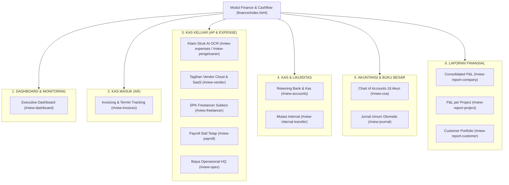
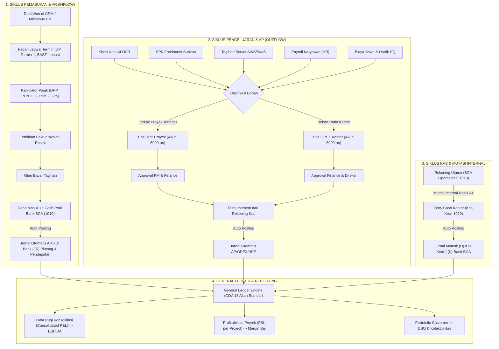
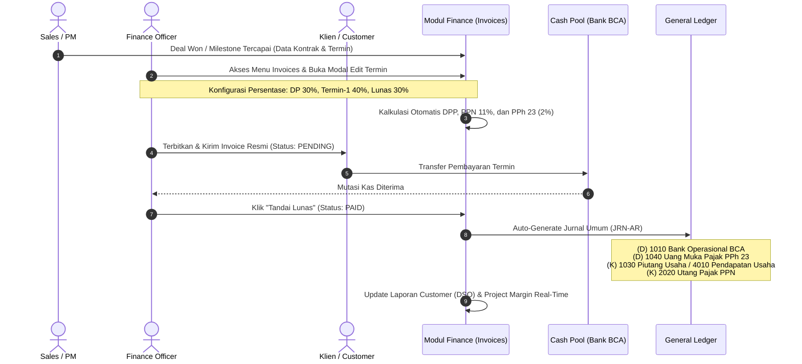
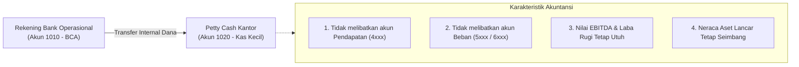
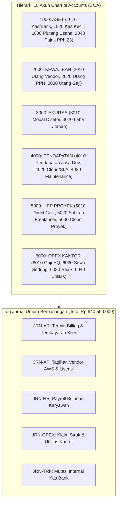
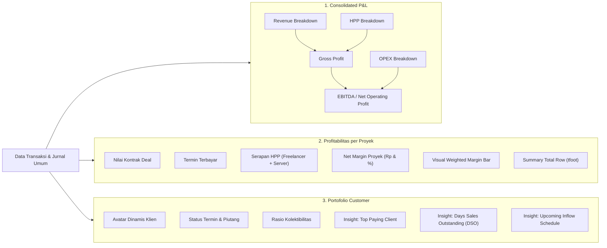
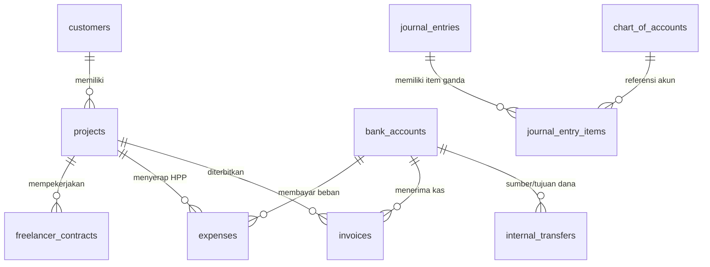

# RESUME ALUR WORKFLOW MODUL FINANCE & CASHFLOW MANAGEMENT
# ASTACODE ERP PLATFORM
### Arsitektur Alur Kerja Keuangan Software House: Cash Pool, Termin Billing, HPP vs OPEX, Double-Entry General Ledger & Multi-Level Reporting

---

| Dokumen | Keterangan |
| :--- | :--- |
| **Nama Modul** | Finance & Cashflow Management (Finance V3) |
| **Acuan Dokumen** | `PRD_Finance.md` & `MASTER_PRD.md` |
| **Platform** | ASTACODE ERP Platform |
| **Target Pengguna** | Finance & Accounting, Project Manager (PM), Director / Owner |
| **Fokus Arsitektur** | Cash Pool Terpadu, Milestone Billing (Termin AR), HPP Proyek vs OPEX Kantor, Double-Entry General Ledger, Multi-Level Financial Reporting |
| **Lokasi Modul** | `d:\PROJECT SAYA\prototype-erpasta\finance\` (`index.html`, `finance.js`, `finance.css`) |
| **Status Sistem** | 🟢 FINAL (Aligned & Up-to-Date) |

---

## 1. Ringkasan Eksekutif & Visi Arsitektur

Modul Finance Astacode ERP dirancang secara spesifik untuk model bisnis **Software House & Digital Agency Modern**. Berbeda fundamental dari akuntansi manufaktur atau retail konvensional yang kaku dan sarat persediaan barang fisik, modul Finance mengadopsi 4 pilar arsitektur utama:

1. **Prinsip Cash Pool Terpadu**: Seluruh penerimaan pembayaran termin klien (Uang Muka/DP, Progress Milestone Deliverable, BAST, dan Pelunasan) langsung terkonsolidasi ke rekening kas likuid utama perusahaan.
2. **Pemisahan Tegas HPP Proyek vs OPEX Kantor**:
   * **Beban Pokok Produksi (HPP Proyek)**: Pengeluaran langsung terkait deliverable proyek, seperti upah subkontraktor/freelancer SPK, langganan server cloud AWS staging/production proyek, dan lisensi API khusus klien. Beban ini memotong margin kotor proyek bersangkutan secara *real-time*.
   * **Beban Operasional Kantor (OPEX HQ)**: Biaya umum dan operasional rutin kantor, seperti gaji pokok staf tetap (Payroll HR), sewa gedung kantor, internet dedicated, utilitas listrik PLN, dan konsumsi operasional.
3. **Buku Besar Otomatis (Zero Manual Double-Entry General Ledger)**: Setiap transaksi operasional (pembayaran invoice, klaim struk OCR, SPK freelancer, mutasi internal) langsung men-generate entri jurnal berpasangan debit-kredit seimbang (*balanced*) dengan nomor akun COA standar, tanpa input jurnal manual yang rentan human-error.
4. **Pelaporan Finansial Multi-Dimensi (Multi-Level Reporting)**:
   * **Consolidated P&L**: Laba rugi perusahaan konsolidasi dengan breakdown sub-item hingga laba bersih operasional (EBITDA).
   * **Profitabilitas per Proyek (P&L per Project)**: Visibilitas margin riil tiap proyek dengan *Visual Weighted Margin Bar* dan *Summary Total Row (`<tfoot>`)*.
   * **Portofolio per Customer**: Pemantauan profil klien, rasio kolektibilitas, *Days Sales Outstanding (DSO)*, dan kalender piutang jatuh tempo.

---

## 2. Arsitektur Informasi & Navigasi Modul Finance

Modul Finance terbagi dalam 6 domain fungsional yang saling terhubung:

---

## 3. Matriks Transformasi Alur Kerja (AS-IS vs TO-BE)

| Aspek Finansial | Alur Kerja Konvensional (AS-IS) | Alur Kerja Tersistem Astacode Finance (TO-BE) | Dampak & Efisiensi |
| :--- | :--- | :--- | :--- |
| **Penagihan Termin Klien** | PM lupa memberi tahu milestone selesai; Finance membuat invoice manual di Excel/Word. | Terintegrasi otomatis dari CRM Deals Won & Milestone PM; termin langsung terbit dengan kalkulator pajak PPN 11% & PPh 23 (2%). | **Invoice terbit tepat waktu**; DSO terpangkas hingga 40%. |
| **Pencatatan Biaya Proyek vs Kantor** | Semua nota dan transfer bercampur di rekening yang sama tanpa label per proyek. | Pemisahan tegas real-time: SPK Freelancer & AWS langsung memotong HPP Proyek; Payroll & Sewa kantor masuk pos OPEX Konsolidasi. | **Margin proyek akurat 100%**; mencegah kebocoran margin tersembunyi. |
| **Klaim Pengeluaran Operasional** | Nota fisik dikumpulkan di map, sering hilang, rekap manual akhir bulan. | AI OCR Drag & Drop: sistem membaca nama vendor, tanggal, nominal struk, dan otomatis mengisi form klaim. | **Klaim instan & paperless**; verifikasi nota dalam hitungan detik. |
| **Pencatatan Buku Besar (General Ledger)** | Staf akuntansi mengetik jurnal debit-kredit manual satu per satu; sering selisih/tidak balance. | Double-Entry Otomatis: Setiap transaksi AR, AP, HR, OPEX, dan Mutasi menghasilkan jurnal seimbang (Total Rp 640.500.000). | **Zero human error**; pembukuan selalu seimbang (*balanced*). |
| **Pemindahan Dana Kas Kecil** | Mutasi transfer antar rekening kantor sering salah dicatat sebagai beban/biaya rugi-laba. | Fitur Mutasi Internal: memindahkan dana antar rekening kas likuid secara non-P&L tanpa mengganggu laporan laba rugi. | **Saldo kas riil sinkron**; laporan P&L tetap valid. |
| **Analisis Profitabilitas Proyek** | Baru dihitung setelah proyek selesai, sering terkejut proyek ternyata rugi (*burn-rate* tinggi). | Laporan Laba Rugi per Proyek real-time dengan Visual Margin Bar dan baris total ringkasan (`<tfoot>`). | **Early warning system** terhadap proyek *over-budget*. |

---

## 4. Resume Rinci Alur Workflow Modul Finance

Berikut adalah visualisasi menyeluruh hubungan antar proses bisnis dan aliran dana dalam modul Finance:

---

### 4.1 Workflow 1: Manajemen Penagihan & Termin (Invoicing & Accounts Receivable)

Alur ini mengelola siklus piutang usaha dari kesepakatan penjualan hingga pencairan kas:

* **Aturan Bisnis & Pajak Terintegrasi**:
  * **DPP (Dasar Pengenaan Pajak)** = Nilai Bruto Termin Kontrak.
  * **PPN (11%)** = Ditambahkan pada invoice sebagai kewajiban pajak keluaran klien.
  * **PPh 23 (2% Jasa)** = Dipotong sebagai kredit pajak perusahaan (Uang Muka Pajak PPh 23).
  * **Total Kas Diterima (Net Inflow)** = `DPP + PPN 11% - PPh 23 2%`.

---

### 4.2 Workflow 2: Pengeluaran Fleksibel (HPP Proyek vs OPEX Kantor)

Memastikan setiap rupiah yang keluar terkategori secara akurat antara beban deliverable proyek dan operasional umum kantor.

#### A. Sub-Workflow Klaim Struk AI OCR
1. Karyawan atau tim lapangan mengunggah foto struk/nota (*drag-and-drop receipt image*).
2. Mesin AI OCR membaca teks gambar dan otomatis mengekstrak: **Nama Vendor/Merchant**, **Tanggal Transaksi**, dan **Nominal Rupiah**.
3. Finance meninjau hasil ekstraksi dan memilih alokasi akun:
   * Jika untuk proyek tertentu (misal: transportasi ke kantor klien proyek) $\rightarrow$ dialokasikan ke **5010 HPP Proyek**.
   * Jika untuk kebutuhan rutin kantor $\rightarrow$ dialokasikan ke **6040 Beban Operasional Kantor**.
4. Pembayaran dicairkan melalui Kas Kecil atau Transfer Bank, dan sistem menerbitkan jurnal pengeluaran otomatis.

#### B. Sub-Workflow SPK Subkontraktor / Freelancer (HPP Proyek)
1. Project Manager menerbitkan Surat Perintah Kerja (SPK) untuk freelancer dengan referensi proyek terkait (misal: *Samudera Logistik App*).
2. Kontrak memuat milestone deliverable (misal: Slicing UI, Integrasi Payment Gateway).
3. Setelah deliverable diverifikasi oleh PM, invoice freelancer diajukan ke Finance.
4. Finance memproses pembayaran yang langsung didebit ke akun **5020 Beban Subkon & Freelancer**.
5. Sistem otomatis memotong margin laba proyek pada laporan **Profitabilitas Proyek**.

#### C. Sub-Workflow Tagihan Vendor Cloud & Lisensi API
1. Tagihan berkala dari penyedia infrastruktur (AWS, Google Cloud, lisensi GitHub Enterprise, SendGrid).
2. Jika server dedicated untuk proyek klien $\rightarrow$ masuk ke **5030 Beban Cloud & Server Proyek**.
3. Jika alat kerja internal kantor $\rightarrow$ masuk ke **6030 Beban Langganan Software/SaaS**.
4. Terjadwal jatuh tempo pada widget peringatan dashboard untuk mencegah suspensi layanan.

#### D. Sub-Workflow Payroll Karyawan Tetap (OPEX)
1. Rekapitulasi penggajian staf tetap bulanan disinkronkan dari data HR.
2. Meliputi gaji pokok, tunjangan kehadiran, dan potongan BPJS.
3. Dicatat langsung ke pos **6010 Beban Gaji & Upah Karyawan Tetap**.
4. Beban ini masuk ke laporan laba rugi konsolidasi perusahaan tanpa membebani HPP proyek teknis individual.

---

### 4.3 Workflow 3: Kas, Rekening Bank & Mutasi Internal (Non-P&L)

Mengatur likuiditas tanpa menyebabkan kesalahan distorsi pada laporan laba rugi:

* **Tujuan**: Mengisi kembali (*replenish*) dana kas kecil untuk kebutuhan kas operasional harian kantor.
* **Auto-Journaling**:
  * `[DEBIT]` 1020 - Kas Kecil (Petty Cash)
  * `[KREDIT]` 1010 - Bank BCA Operasional
* Transaksi ini diberi tanda modul sumber `[TRF]` pada Jurnal Umum dan tidak pernah mempengaruhi nilai laba bersih perusahaan.

---

### 4.4 Workflow 4: Pembukuan Ganda Otomatis (General Ledger Engine)

Seluruh modul operasional dihubungkan oleh mesin akuntansi otomatis yang mengacu pada **Chart of Accounts (COA) 18 Akun Standar Industri Software House**:

* **Audit Saldo Seimbang (*Balanced Equilibrium*)**: Total debit dan kredit pada prototipe terkunci seimbang pada angka **Rp 640.500.000**.
* **Fitur Tata Kelola COA**: Dilengkapi tombol modal *Tambah Akun Baru*, *Edit Akun*, dan *Hapus Akun* dengan validasi kategori akuntansi.

---

### 4.5 Workflow 5: Pelaporan Finansial Multi-Dimensi (Multi-Level Reporting)

Siklus akhir dari data finansial adalah penyajian wawasan strategis untuk para pemangku kepentingan:

1. **Laporan Laba Rugi Konsolidasi (Consolidated P&L)**:
   * Menyajikan rincian sub-item per kategori: Pendapatan Pengembangan Khusus, Pendapatan SLA, HPP Freelancer, HPP Server Proyek, OPEX Gaji Staf, Sewa Gedung, hingga Listrik & Internet.
   * Menghasilkan indikator laba kotor (*Gross Margin*) dan laba bersih operasional (*EBITDA*).
2. **Laporan Profitabilitas Proyek (P&L per Project)**:
   * Mengukur kesehatan delivery proyek perangkat lunak secara satuan.
   * Dilengkapi indikator grafis **Visual Margin Bar** (misal: margin sehat > 70%) dan baris kesimpulan **Summary Total Row (`<tfoot>`)** yang menjumlahkan seluruh portofolio proyek.
3. **Laporan Portofolio per Customer**:
   * Menampilkan rekapitulasi akun klien dengan avatar gradasi elegan.
   * Dilengkapi 3 buah **Summary Insight Cards**:
     * *Top Paying Client*: Klien dengan kontribusi pendapatan tertinggi.
     * *Days Sales Outstanding (DSO)*: Kecepatan rata-rata klien melunasi tagihan.
     * *Upcoming Inflow Schedule*: Proyeksi kas masuk dalam 14 hari ke depan.

---

## 5. Blueprint Skema Entitas Data (ERD Modul Finance)

Struktur tabel relasional yang menopang seluruh alur workflow Finance:

### Rincian Kamus Data Entitas:
1. `projects`: `id`, `name`, `client_id`, `total_contract_value`, `start_date`, `status`
2. `customers`: `id`, `name`, `code`, `sector`, `pic_name`, `phone`, `email`
3. `invoices`: `id`, `project_id`, `termin_name`, `dpp_amount`, `ppn_rate`, `pph_rate`, `total_amount`, `due_date`, `status`
4. `expenses`: `id`, `project_id` (nullable), `category` (HPP / OPEX), `amount`, `vendor_name`, `receipt_file`, `status`
5. `freelancer_contracts`: `id`, `project_id`, `freelancer_name`, `spk_number`, `role`, `total_fee`, `status`
6. `bank_accounts`: `id`, `bank_name`, `account_number`, `account_holder`, `balance`, `account_type`
7. `internal_transfers`: `id`, `from_account_id`, `to_account_id`, `amount`, `transfer_date`, `notes`
8. `chart_of_accounts`: `account_code`, `account_name`, `category_code`, `normal_balance`, `current_balance`
9. `journal_entries`: `id`, `entry_number`, `source_module` (AR / AP / HR / OPEX / TRF), `transaction_date`, `description`, `total_debit`, `total_credit`
10. `journal_entry_items`: `id`, `journal_entry_id`, `account_code`, `debit`, `credit`

---

## 6. Integrasi Lintas Modul (Cross-Module Data Bridges)

Modul Finance beroperasi sebagai muara moneter terpusat dalam ekosistem Astacode ERP:

1. **Jembatan CRM $\rightarrow$ Finance**:
   * *Trigger*: Peluang bisnis berubah status menjadi `DEAL WON`.
   * *Payload Data*: `{ deal_id, client_id, project_name, contract_value, payment_terms }`.
   * *Aksi Finance*: Otomatis mendaftarkan draft termin pada modul Invoicing (AR).
2. **Jembatan Project Management (PM) $\rightarrow$ Finance**:
   * *Trigger*: Milestone pekerjaan / UAT disetujui (*Approved*).
   * *Payload Data*: `{ project_id, termin_number, milestone_name, percentage, due_date }`.
   * *Aksi Finance*: Mengaktifkan tombol terbitkan faktur penagihan resmi ke klien.
3. **Jembatan Marketing / PM $\rightarrow$ Finance (AP Claims)**:
   * *Trigger*: Pengajuan klaim anggaran iklan atau biaya operasional proyek.
   * *Payload Data*: `{ department: "Marketing"|"PM", expense_type, amount, receipt_url, project_id }`.
   * *Aksi Finance*: Masuk antrean verifikasi klaim pengeluaran untuk dicairkan.

---

## 7. Kebijakan Fitur yang Ditiadakan (Deprecated & Removed)

Berdasarkan kesepakatan desain arsitektur pada `PRD_Finance.md`, fitur-fitur konvensional pabrik/manufaktur berikut **telah dihapus sepenuhnya** demi menjaga modul tetap ramping, cepat, dan relevan dengan industri digital:

* ❌ **Rekonsiliasi Bank Otomatis (Dynamic CSV & Tinder Matching)**: Ditiadakan karena seluruh transaksi mutasi kas tercatat secara langsung dan *real-time* via rekening kas dan mutasi internal.
* ❌ **Aset Tetap & Depresiasi Mesin Pabrik**: Ditiadakan karena software house berfokus pada talenta intelektual dan aset komputasi awan yang langsung dibebankan secara operasional.
* ❌ **Modul Kepatuhan Pajak DJP Terpisah**: Ditiadakan; kewajiban PPN 11% dan bukti potong PPh 23 disematkan langsung pada transaksi penagihan riil.
* ❌ **Budgeting & Cost Centers Terpisah**: Ditiadakan; pengendalian anggaran biaya langsung dipantau melalui laporan **Profitabilitas per Proyek**.

---

## 8. Ringkasan Status Implementasi & Verifikasi Prototipe

Seluruh 7 butir kesepakatan penataan teknis pada `PRD_Finance.md` telah terealisasi 100% pada prototipe `finance/`:

| No | Modul / Komponen | Realisasi Implementasi | Status |
| :---: | :--- | :--- | :---: |
| 1 | **Jurnal Umum Otomatis** | 9 Entri Jurnal berpasangan lengkap dengan filter sumber (AR, AP, HR, OPEX, TRF) & status seimbang Rp 640.500.000. | 🟢 **DONE** |
| 2 | **Chart of Accounts (COA)** | 18 Akun standar industri digital, modal Tambah Akun, modal Edit Akun, dan aksi Hapus dengan auto-recalculate counter. | 🟢 **DONE** |
| 3 | **Consolidated P&L** | Sub-item breakdown mendalam pada Pendapatan (4 item), HPP (4 item), dan OPEX (6 item) dengan kalkulasi EBITDA presisi. | 🟢 **DONE** |
| 4 | **P&L per Project** | Komparasi 4 proyek aktif, baris `<tfoot>` total agregat, dan visual progress margin bar dinamis. | 🟢 **DONE** |
| 5 | **Laporan Customer** | Profil klien ber-avatar gradasi, status kolektibilitas termin, dan 3 kartu metrik ringkasan (Top Paying, DSO, Upcoming Inflow). | 🟢 **DONE** |
| 6 | **Dashboard Interaktif** | Toggle periode grafik arus kas (3 Bulan, 6 Bulan, 1 Tahun) dan donut chart alokasi biaya dengan tooltip persentase. | 🟢 **DONE** |
| 7 | **Modal & Notifikasi** | Modal dialog responsif, backdrop click handler, ESC key close, dan toast notification interaktif. | 🟢 **DONE** |

